# SignGrid(サイングリッド)/ 看板カルテ

**看板製作会社の有資格者が、紙とスマホ写真で回している点検と法規の確認を、看板1基=1行の台帳と「カルテ」に載せるシステム。AI は下書きまで、確定は有資格者。**

デモ動画(3 分・日本語): https://youtu.be/S9r0nuLufuY

動く見本(見本データ・架空の店、見る側に鍵は不要): https://signgrid.srv1601539.hstgr.cloud (点検会社 `/`、看板の持ち主 `/owner/`、行政 `/gov/`、街の人 `/report/`、アノテーション `/expert/`)。審査のための閲覧用で、AI の下書きと寸法の推定も動く(鍵はサーバ側に設定済み)。

**人が確定する**: AI が出すのは下書きだけ。判定の確定と署名は有資格者(屋外広告士)が行う。画面には事実確認の根拠(写真番号・条文)が残る。

Built with Claude: Japan 2026(開発開始 2026-11-02 12:30 JST)の作品。期間中にゼロから作った。

## 1. 何の不便か

- 看板の点検は、現場で撮った写真(LINE)と手書きの点検票で回っている。台帳に載らず、前回との差も、条例ごとの許可・義務も人の頭の中にある。
- 論文は「落ちた看板の8割は行政が把握していない(自家用43+無許可30 / 89、日本建築学会 2026-07)」と指摘する(`docs/IMPACT.md`)。
- 自社の指示書 29,034 件のうち、直取引で住所が現地と見なせる屋外の看板 154 件を数えると、**許可不要の自家用 = 行政への点検報告の網に掛からない看板は 8 基(5.2%)**。ただし自社の看板の9割以上は代理店経由で場所が未確定なので、全体の率ではなく下限(`docs/IMPACT.md`)。
- そのうえ許可不要でも、埼玉県は点検の義務、越谷市・さいたま市は点検と有資格者の義務がある(`docs/LEGAL.md` の24ケース表)。「許可がいらない = 何もしなくてよい」ではない。

## 2. 3つの入口と6つの画面

入口は「誰の仕事か」で3つに分かれる(それぞれ別のページ、別のタイトル)。見本データ(架空の店)で動く。点検会社の画面は 2026-11-08 に新 UI(`/v3/`)へ: `/` は `/v3/`(PC: ホーム → 新規点検 N1 物件 → N2 入口 → N3 取り込み → N4 不明点 → N5 看板ごとの確認 → N6 署名 → N7 報告書、L 台帳、K 判定の規則)に転送、現場は `/v3/field/`(スマホ)。旧画面(受付・台帳・規則と出力)は `/index.html` に残る。スクリーンショットは `docs/img/`(`python3 tools/web_screenshots.py` で撮り直せる)。

| 入口 | 使う人 | 画面 |
|---|---|---|
| **① 点検会社**(`/v3/`、SignGrid。屋外広告士がいて点検を仕事にしている会社) | 職人 | **現場のスマホ画面**(`/v3/field/`)。案内どおりに 位置 → 全景 → 正面 → 部位 → 寸法と所見 の順に撮って送る。LINE の入口も残る(写真を送るだけ、または「ガイド付き点検」で a/b/c を押す。初回は台帳に寸法が無ければ「寸法の実測」も聞く、`docs/LINE.md`) |
| | 有資格者(屋外広告士) | **カルテ**(スマホ / PC)。AI の下書きを18項目で確認し、黄色(判断できず)を直して「確定して署名」 |
| | 事務・営業 | **受付・台帳・規則と出力**(PC)。受け付けた束、台帳、規則の承認、東京都 第2号様式・客先A型の xlsx 出力 |
| **② 看板の持ち主**(`/owner/`、商店や企業。QR で開く) | 店舗オーナー | **許可の要否と義務の画面**(スマホ)。写真と住所から、許可の要否と点検まわりの4義務を条文つきで調べる。「看板屋に点検を頼む」へ |
| **③ 行政**(`/gov/`、SignGrid 行政) | 巡回の職員 | **「撮る→送る」**(スマホ)。写真の EXIF GPS(無ければ端末の現在地)で看板ごとに束ね、台帳との一致候補と地図に出す(`docs/GOV.md`「スマホからの投入」) |
| | 窓口 | **一括登録と地図**(PC)。職員が撮った写真を位置で束ね、台帳と突き合わせて地図に「未申請の疑い・許可期限切れ / 期限が近い・許可情報が未記入 / 許可あり / 位置なし」で出す(`docs/GOV.md`) |

台帳と API は3入口で共通。行政の画面から点検会社のカルテへは入れない(別の組織)。

**街の人の入口 `/report/`(試作、7 節)**: ログイン不要で、見かけた看板の写真と位置(無ければ住所)と一言を送る。受付番号で状態だけが見られる。判定は見せない。

### ① 点検会社(`/`)

画像は要所の切り出し。クリックすると画面全体のキャプチャが開く。

<table>
<tr>
<td align="center" valign="top" width="36%"><a href="docs/img/guide-karte-sp.png">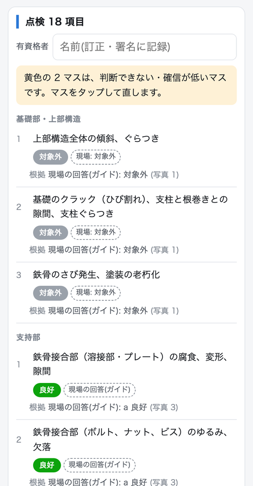</a><br><sub>職人: 現場のスマホ画面(<code>/v3/field/</code>)や LINE のガイド付き点検の結果を、カルテのバッジ「現場の回答」で確認</sub></td>
<td align="center" valign="top" width="64%"><a href="docs/img/guide-measure-pc.png">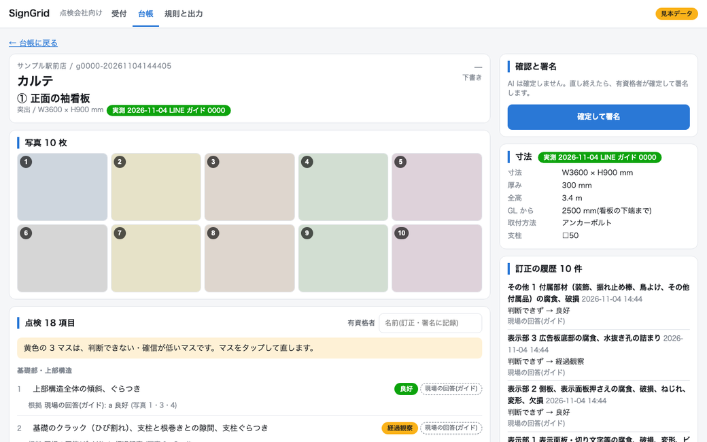</a><br><sub>職人: 寸法の実測(初回だけ。飛ばせる。図は LINE の会話を模擬した画面)</sub></td>
</tr>
</table>

<table>
<tr>
<td align="center" valign="top" width="36%"><a href="docs/img/karte-sp.png"></a><br><sub>有資格者: カルテ(黄色は判断できず)</sub></td>
<td align="center" valign="top" width="64%"><a href="docs/img/ledger-pc.png">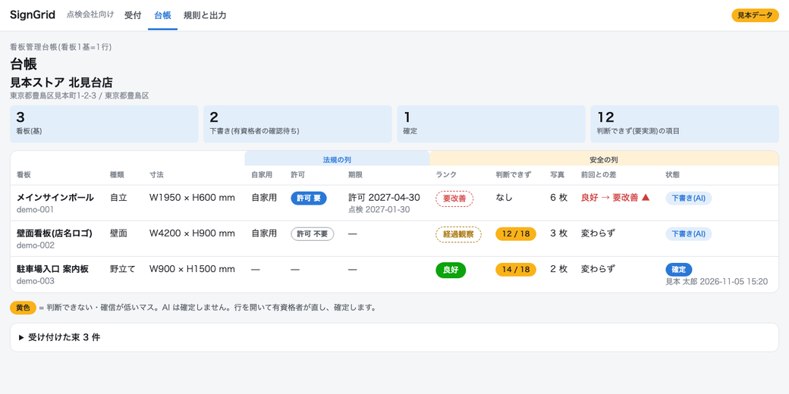</a><br><sub>事務・営業: 台帳</sub></td>
</tr>
</table>

**ガイド付き点検は、全景の次に表示面の正面(各面)を撮り、看板の種類を選ぶ**: 部位ごとの問いに、種類に合わせた撮る場所が 1 行付く(高所に登らせない。傾きは全景で見る)。**寸法の実測は初回だけ**: 台帳にその看板の寸法が無い時、幅・高さ・厚み(任意)・GL(地面から看板の下端まで)・取付方法(一覧か文字)・支柱を聞く。図面があれば「図面で送る」、要らなければ「飛ばす」で通せる。2回目以降は前回の実測を引き継ぎ、聞かない(`docs/LINE.md`)。

### ② 看板の持ち主(`/owner/`)

<table>
<tr>
<td align="center" valign="top"><a href="docs/img/owner-saitama-sp.png">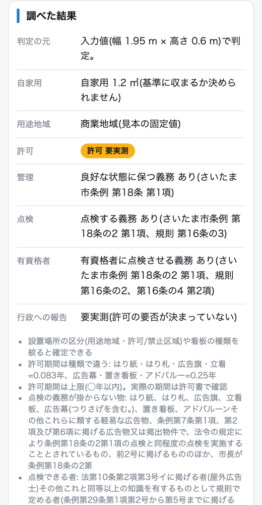</a><br><sub>さいたま市の条文つき</sub></td>
</tr>
</table>

**写真から推定した寸法のまま調べると、推定の範囲の両端で判定する(両端で結論が分かれた項目は「要実測」。欄を手で直すと入力値で判定)**: [owner-judge-range-sp](docs/img/owner-judge-range-sp.png)

### ③ 行政(`/gov/`)

<table>
<tr>
<td align="center" valign="top" width="36%"><a href="docs/img/gov-capture-sp.png">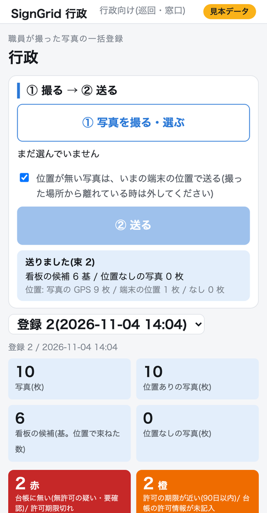</a><br><sub>巡回(スマホ。撮る→送る、送った直後)</sub></td>
<td align="center" valign="top" width="64%"><a href="docs/img/gov-capture-pc.png">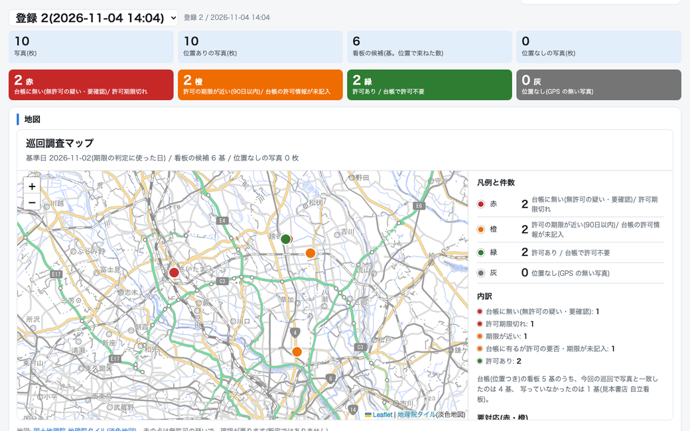</a><br><sub>窓口(PC。一括登録と地図)</sub></td>
</tr>
</table>

## 3. 知識が育つ工程

ベテランの判断を本人が現場にいるうちに、次の人が受け継げる形にする。**承認だけが次の下書きに効く**(`docs/WORKFLOW.md`、`docs/PIPELINE.md`)。

声・写真 → **AI の下書き** → **有資格者の訂正** → **1問の聞き返し** → **規則の候補** → **承認** → **矛盾の検出** → 次の下書きに効く

<table>
<tr>
<td align="center" valign="top" width="50%"><a href="docs/img/workflow-1-draft-sp.png">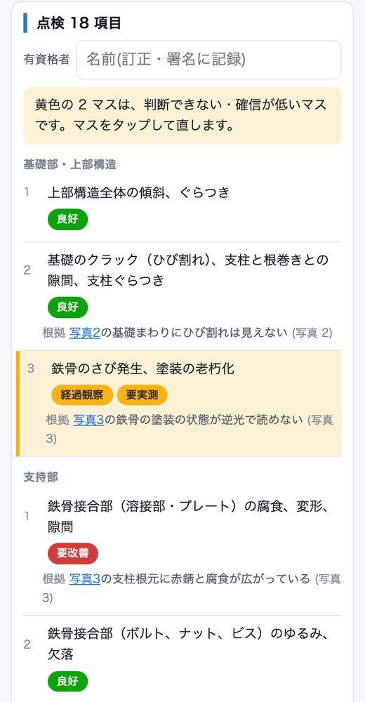</a><br><sub><b>1</b> AI の下書き。黄色は判断できない・確信が低いマス</sub></td>
<td align="center" valign="top" width="50%"><a href="docs/img/workflow-2-clarify-sp.png">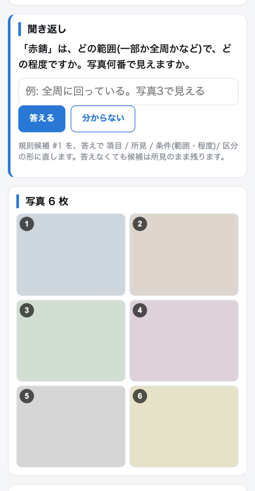</a><br><sub><b>2</b> 「赤錆」とだけ訂正すると、範囲・程度・写真番号を1問だけ聞き返す</sub></td>
</tr>
<tr>
<td align="center" valign="top" width="50%"><a href="docs/img/workflow-3-candidate-sp.png">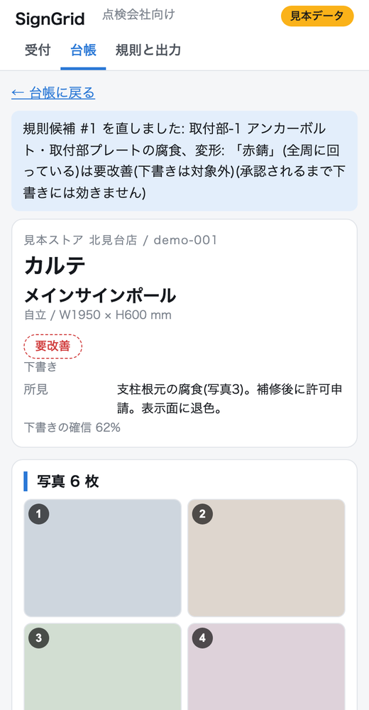</a><br><sub><b>3</b> 答えで、規則が 項目 / 所見 / 条件 / 区分 の形で候補に積まれる</sub></td>
<td align="center" valign="top" width="50%"><a href="docs/img/workflow-4-conflict-sp.png">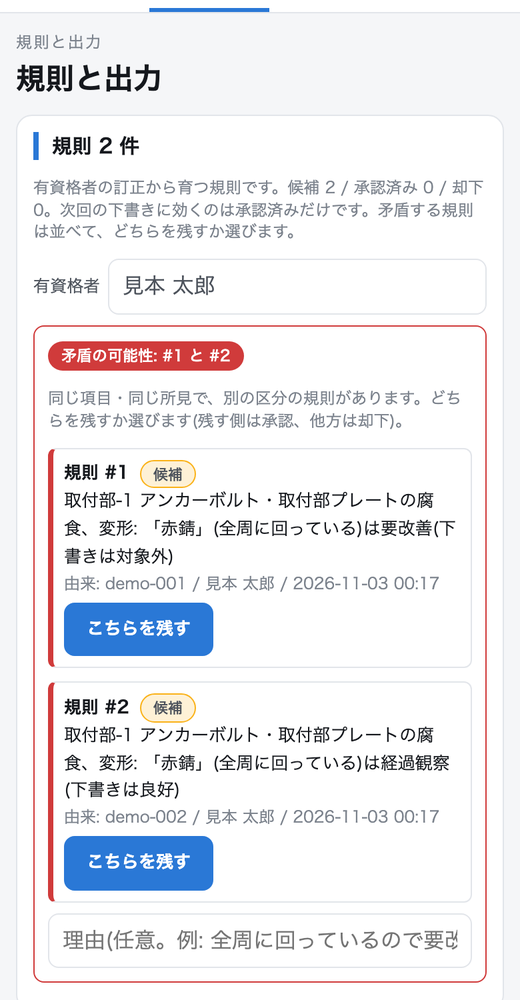</a><br><sub><b>4</b> 同じ条件で別の区分の訂正が入ると、2つの規則を並べて矛盾を知らせる</sub></td>
</tr>
<tr>
<td align="center" valign="top" width="50%"><a href="docs/img/workflow-5-not-yet-sp.png">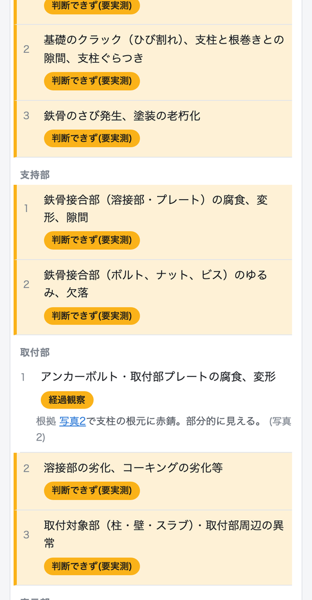</a><br><sub><b>5</b> 候補のままでは次の下書きに効かない</sub></td>
<td align="center" valign="top" width="50%"><a href="docs/img/workflow-6-approved-sp.png">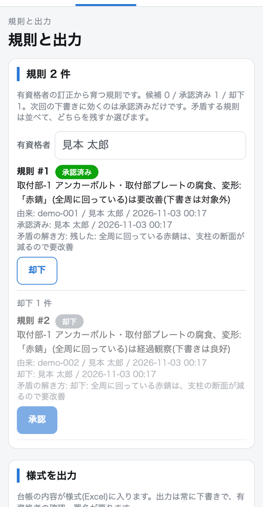</a><br><sub><b>6</b> 「こちらを残す」1操作で、承認と却下、理由と承認者が残る</sub></td>
</tr>
<tr>
<td align="center" valign="top" width="50%"><a href="docs/img/workflow-7-effect-sp.png">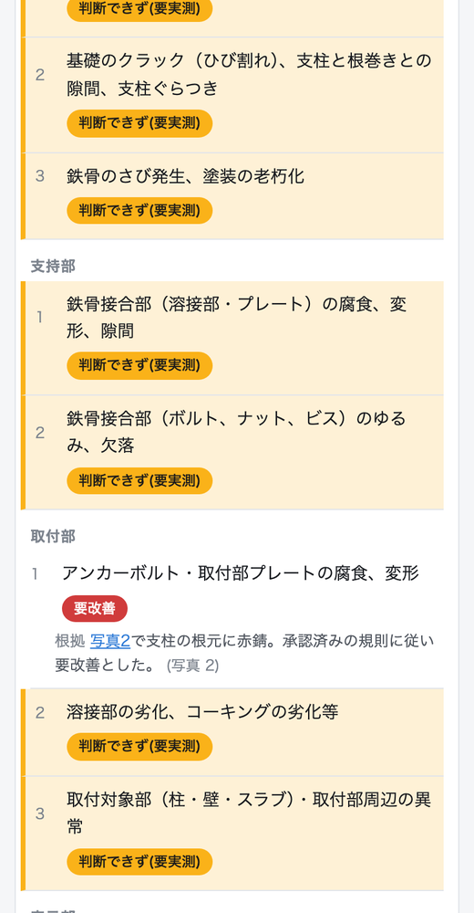</a><br><sub><b>7</b> 承認済みの規則に従って、同じ看板の下書きが変わる</sub></td>
</tr>
</table>

- 規則に顧客名・店名は入らない(項目名・所見・条件・区分だけ)。
- 一周は固定値の見本の判定役で通す(API なし)。7 の下書きで他の17項目が黄色なのはそのため。
- **正直な測定**: 承認済み規則 6 本を入れた 102 基の評価は、完全一致 71.6%・±1 99.0% で、規則なしと**同じ**だった(規則が当たる看板が少ない)。規則が効くことは、この測定では示せていない(`docs/PIPELINE.md` §3)。

## 4. 点検(安全)

看板1基を 18 項目 × 3 段階(良好 / 経過観察 / 要改善)で下書きする(東京都 第2号様式の18項目)。ランクは 1 良好〜4 即時対応。見逃し(要対応を「大丈夫」と言う)を最も重く見る(`docs/EVAL.md`)。

**評価(自社の点検記録 829 基。非公開、評価の正解としてのみ参照)** — 全量、写真6枚まで、例示6、規則なし:

| 判定役 | 完全一致 | ±1 以内 | 要対応の見逃し | 誤警報 | 項目一致 | 費用 |
|---|---|---|---|---|---|---|
| 常に 2(定数) | 29.9% | 98.9% | 100.0% | 0.0% | 10.7% | - |
| Sonnet 5.5 | 59.1% | 94.8% | 72.2% | 7.4% | 68.7% | $9.00 |
| Opus 5.5 | 66.5% | 93.8% | 76.7% | 4.9% | 75.8% | $20.95 |

正解は点検者の自己申告で「点検者との一致率」。ランクの偏りが大きい(定数でも約3割当たる)ので、定数と並べて読む。**要対応は4分の3を見逃している**。AI の下書きを人が確定する理由は、ここにある。

**一周の実測(客先の 2026年 1店舗: LINE 写真 1,398 枚 + 手書きの点検票スキャン 140 頁。評価 829 基に入っていない店)**(`docs/FIELD.md`)

| 指標 | 値 |
|---|---|
| 一周(PDF 登録 → 69 基の下書き → 様式出力) | 約 9 分(537 秒)、API $7.44 |
| 1 ラウンド(別の客先の 32 店舗 271 基。Excel 貼付の写真 1,279 枚 → 下書き → 客先A型 xlsx 32 本、2026-11-08) | **7 分 52 秒**(472 秒: 登録 0.8 / 下書き 460.3 / 出力 11.3)、Sonnet 5.5、4 並列、API $6.18。同じ客先の 1 ラウンド(45 店舗)の事務作業は 80 時間(自社の記録、2026-07)。判定の質は未測定(写真は Excel 貼付の縮小版) |
| **現場の一周(LINE のガイド付き点検、実物の看板 2 基、屋外広告士本人、2026-11-05、人の確認込み)** | 位置送信から 2 基目の記録まで **22 分 51 秒**(2 基目は 2 回目の位置送信から 16 分 24 秒= **1 基 約 8 分**)。写真 16 枚、項目 11+7、webhook 82 件 エラー 0、台帳に 2 基(下書き)。API 0(判定は本人、v3 の時点) |
| 手書き点検票の転記の照合(Sonnet 5.5 ↔ Opus 5.5、15 頁) | 判定欄の一致 97/102 = 95.1% |
| 完全一致(47 基、Opus 5.5) | 70.2%(33/47) |
| 要対応の見逃し | **5/9** |
| 誤警報 | 1/38 |
| 黄色(判断できず) | 69 基 × 18 項目のうち 62.5%(昼の写真で見えない項目が大半) |

限界: 1店舗・47 基で、要対応は 9 基(ランク4は 0)。現場の一周は 1 人・2 基・1 回(v3、自動下書き前)の実測で、慣れや看板の数で変わる。例示は同じ店の別の看板。他の店へ一般化した数字ではない。

## 5. 法規(許可・義務)

点検とは別の判断(`docs/LEGAL.md`、`docs/GIS.md`)。

- **4自治体の条例原文から規則を AI が抽出**: 東京都・埼玉県・越谷市・さいたま市(条例と施行規則の8本)。答えには根拠条文(条・項・号と原文の抜粋)が付く。
- **許可の要否**: 要 / 不要 / 要実測の3段階。寸法が分からなければ「要実測」に倒す(保守側)。ガイド付き点検の初回に寸法を実測して台帳に入れると、カルテを開くたびに面積と全高で再判定され、この「要実測」が減る。寸法の出どころはカルテのバッジ(実測 / 推定(AI) / 図面 / 未入力)で分かる。客先 1店舗の 74 基(図面のスケッチから W・H を読んだ場合)では、許可の要実測が 6 基から 3 基に減った(不要 / 要 / 要実測 = 67 / 4 / 3、`docs/FIELD.md`)。
- **用途地域と全高を接続**: 住所 → 国土地理院で座標化 → 国土交通省の用途地域 GIS(埼玉県 58 + 東京都 52 = 110 本、15,783 ポリゴン)で区分を引き、判定に渡す。禁止地域は用途地域だけの暫定(風致・景観・文教などは未判定)。GIS は参考値。
- **4つの義務**: 管理 / 点検 / 有資格者 / 行政への報告を別々に判定する。東京都の有資格者は「有資格の屋外広告物管理者を置く」義務(点検をさせる義務ではない)。24 ケースの表は `python3 tools/duties_matrix.py`(API なし)。
- **限界**: 条例の写しは 2026-10-20 時点。使う前に最新の例規集と突き合わせる。埼玉県の他の市町村は県条例で引き、市独自条例は未確認。

## 6. ハッカソンの後、誰がどう使い続けるか

- **看板製作会社の有資格者と事務**: 客先の点検(紙の点検票とスマホ写真)を、看板1基=1行の台帳とカルテに載せる。有資格者は AI の下書きを確認して確定・署名し、事務は台帳と様式出力(東京都 第2号様式・客先A型)を使う。
- **次回の点検**: 前回測った寸法と、確定した判定が台帳に残り、次回のカルテから参照できる。職人は現場のスマホ画面の案内に沿って撮る(LINE で写真を送ることもできる)。
- **行政向け(提案する試作)**: 巡回の「撮る→送る」と地図。職員が撮った写真が位置で看板ごとに束ねられ、この仕組みの台帳との突き合わせと地図に出る。行政の許可情報とはつながっていない(許可の情報は行政の中だけで管理される物。行政向けの画面は行政の端末で動かす前提)。この試作を持って行政への提案を始めている(7 節)。
- **看板の持ち主**: QR で開き、許可の要否と義務を条文つきで調べ、点検を依頼する。
- **未実装・将来**: 行政の許可情報(許可番号・期限・申請者)はこの仕組みに入れない(行政の中だけで管理される物)。`/gov/` の突き合わせは、自社の施工台帳と街の人の報告に対して行う(`docs/GOV.md` の限界)。他の自治体の条例は未対応。
- 見本データで動き、鍵が無くても画面は開く(AI の下書きと寸法の推定だけ鍵が要る)。使い方は Quick start。

## 7. この先の形: 街の人が見つけ、プロが確かめる

SignGrid の主役は 1〜6 節の **点検会社のシステム**(有資格者が確定する台帳とカルテ)。その外側に、**街の人が見かけた看板を送れる入口** を置く試作を作った。呼び名はまだ決めていない(商標を確かめてから付ける)。

**見つけるのは街の人、確かめるのは有資格者。** 街の人には判定を見せない。送られた看板は、この仕組みの台帳(点検の記録+街の人の報告)と突き合わせ、まだ記録のない看板なら有資格者が確かめに行く。

### 7.1 なぜ街の人か: 看板は落ちる、そして多くは行政の目の外にある

**公的資料で裏の取れた落下事故**(すべて 2026-11-04 に原典を確認)

| 年月日 | 場所 | 何が起きたか | 被害 | 出典 |
|---|---|---|---|---|
| 1997-06-20 | 東京都渋谷区 センター街入口 | 旧アーケード看板(約 4 トン)が台風の強風で倒壊。所有者は点検の案内を受けていたが放置 | 死亡 1 | 屋外広告物適正化推進委員会「オーナーさんのための看板の安全管理ガイドブック」2024-06 |
| 2007-06 | 東京都新宿区 | 雑居ビル 1 階の飲食店の看板(1.5m×5m)が落下 | 重傷 1(骨盤骨折)・軽傷 1 | 同ガイドブック / 京都市「広告板等の落下物対策について」 |
| 2015-02-15 | 札幌市中央区 | 高さ約 15m の突出看板の一部が歩道の女性に直撃。取付部の腐食+強風。30 年間、目視のみの点検 | 重体 1 | 国土交通省「広告板落下事故の概要」/ 総務省 北海道管区行政評価局 実態調査(2017-11) |
| 2017-04-10 | 北海道帯広市 | 許可を受けていた地上看板(設置 44 年)の表示面が市道に落下 | なし(許可があっても落ちる例) | 総務省 同調査 |
| 2018-10-29 | 北海道内 | 店舗外壁の金属看板(2.4m×1.2m)が落下。固定の釘が腐食 | 重傷 1 | 国土交通省 建築物等事故・災害対策部会 資料 |
| 2024-07-24 | 埼玉県川口市 | 雑居ビル 2 階の飲食店の看板が強風で落下。許可の要らない看板で、錆が目立っていた | 重傷 1 | 川口市 / 埼玉県議会 2025-03-04 答弁 |

正直な線: 確認できた死亡は 1997 年の渋谷が最後。国土交通省の建築物事故の「看板」区分(2010-12〜2022-11)は 15 件・被害者 10 人・死亡 0。2000 年以降は「重体・重傷」と書く。

**行政の目の外にある、という数字**(一次ソース)

- 国土交通省に報告のあった看板の落下事故 89 件(2021-04〜2024-12)のうち、**許可の要らない自家用 43 件+無許可 30 件 = 73 件(約 8 割)が行政の把握の外**(沼田ほか、日本建築学会計画系論文集 第 91 巻 第 845 号、2026-07。母データの国への報告書は非公開)。
- 北海道の 6 自治体の落下等事故 25 件(2014 年度以降)= 許可不要 12・無許可 9・許可あり 4(総務省 北海道管区行政評価局、2017-11)。
- 許可が要る看板でも申請されていない: 福岡市 表示面 10㎡以上 12,154 件のうち無許可 7,798 件(約 65%、福岡市「参考資料3 無許可広告物是正のこれまでの取組み状況について」)/ 横須賀市 郊外の沿線で申請が要る 634 件のうち未申請 519 件(82%、横須賀市 景観審議会 平成 29 年度資料)。
- 点検の義務は条例にある(埼玉県は許可不要の看板も 3 年ごと。`docs/LEGAL.md`)。ただし行政への報告は許可の申請・更新の時だけで、**許可の要らない看板を外から確かめる人はいない**。「野放し」とは言わない。

8 割の 89 件(落ちた看板)と 6〜8 割(申請されていない看板の実態調査)は、別の調べ方の数字なので混ぜない。

### 7.2 先行事例: 街の人の通報は続いている。看板専用は見つからなかった

| 事例 | 開始 | 規模(公式の数字) | 通報した人に返るもの |
|---|---|---|---|
| FixMyStreet(英国、mySociety) | 2007-03 | 2017-07 に累計 100 万件目 | 自治体が報告ページに対応を書き込む。報告は全公開、メールは非公開、匿名可 |
| ちばレポ(千葉市)→ My City Report | 2014-09 正式 | 2015-04 に投稿 1,095 件・登録 2,887 人 / My City Report は 1 県 10 市 | 受付済・対応中・対応済 が通知で届く |
| Safecast(日本発・国際) | 2011 | 2023-02 に測定 2 億点(CC0 で公開) | 自分が測った値が公開の地図に載る |
| NYC311(ニューヨーク市) | — | 2017 年 3,994 万件(アプリ経由 35 万件) | 看板では「許可に従っていない広告看板」の通報窓口がある |
| 北海道「屋外広告セーフティホットライン」 | 2015-04-01 | 2017-01 時点 28 件 | 業界団体(北広連)が住民の連絡を受けて現地を確かめ、北海道へ渡す。受付は FAX とメール |

- **看板の安全に絞った、街の人のスマホ通報の仕組みは、今回の検索(日本・米国・英国・ドイツ語圏の公式ページ)では見つからなかった。** 存在しないとは言わない(仏・西・中・韓とアプリストアは未検索)。一番近い前例は北海道のホットライン。
- 汎用の窓口が看板の危険を拾った実例はある(ブリストル市の FixMyStreet で、歩道に垂れ下がった看板の通報が同日に手配・翌日に「Fixed」、2026-01-21)。
- FixMyStreet の仕組みを使った各国のサイトのうち **12 サイトは終了**している。通報を集めても、受けて直す側がいないと続かない。

先行事例から読める **続く条件** は 5 つ: ①結果が返る ②本人の得がある ③受けて直す側がいる ④何を公開するかの線がはっきりしている ⑤入口を絞って質を保つ。

### 7.3 通報する人の得: お金は付けない、結果を返す

世界の例で通報者に得があるものは 3 種類あった: お金(NYC のアイドリング通報= 罰金の 25%、韓国 安全新聞庫= 四半期の優秀者に商品券、茨城県 不法投棄= 1 事案 1 万円)/ 地域通貨・ポイント(まちのコイン= 換金不可)/ ゲーム性・自分の記録(Waze のポイント、Safecast の地図)。

| 決め | 理由(先行事例) |
|---|---|
| 現金の報奨は付けない | NYC では通報が少数の常連に集まり、処理が滞り、報酬を下げる条例案が出た(報道と条例案の記録)。看板では店の営業にも響く |
| 報いは「結果が返る」こと | 受付番号で状態が見られる(「この看板は、報告の後に点検されました」)。ちばレポ・FixMyStreet と同じ型 |
| その場の得 | 写真から許可の要否の目安を自分で調べられる(`/owner/` へ写真を引き継ぐ)。分からなければ「要実測」と出る |
| ポイントを付けるなら | 件数でなく、有資格者が確かめて妥当だった報告だけ(未実装・検討) |
| 看板の持ち主の得 | 劣化を早く見つければ補修が小さく済む(和歌山県の資料)。点検の記録で保険が有利になるとは言わない(公式には確認できなかった) |

### 7.4 今ある試作と、まだ無いもの

**今ある(`/report/`、見本データで動く)**

- ログイン不要。写真(カメラ)+位置(ブラウザ。無ければ住所)+気になる所+一言(200 字まで)。名前・連絡先は聞かない。
- 受付番号を返し、`/report/status` で状態と受付日だけが見られる。返す文は「この仕組みの台帳にはまだ無い看板でした。あなたの報告で初めて記録されました。有資格者が、どの看板か確かめます。」など。危ない・無許可の疑いといった判断は街の人に見せない。
- 写真は公開しない。保存時に長辺 1600px に縮め、EXIF(撮影位置を含む)を消す。地図に出す位置は小数 3 桁に丸める。
- `/gov/`(行政に提案する試作)に「市民からの報告」の層(画面の表記のまま): 丸めた位置・状態・受付日だけ。30m 以内の台帳の看板と突き合わせ、記録あり / まだ記録なし / 報告後に点検済み を分ける。
- 送信の上限(1 つの接続元から 1 時間 20 件、写真 8MB まで、JPEG / PNG / WebP)。

**まだ無い(提出版では作らない)**

- 行政の許可情報との突き合わせ。**許可の申請・許可の情報は行政の中だけで管理される物なので、この仕組みには入れない。** 行政向けの画面(`/gov/`)は行政の端末で動かす前提。この試作を持って、行政への提案を始めている(2026-11-05。市名は市の確認が取れてから書く)。
- 受けて直す側の運用(誰が、何日以内に確かめるか)。先行事例の条件 ③ はまだ満たしていない。
- 取り下げ、職員の手による状態の変更、同じ看板の報告のまとめ、住所 → 位置の変換、保存期間の決め。
- 上限の記録はサーバのメモリ上だけ。受付番号を知っていれば誰でも状態が見える(状態と受付日だけ)。
- 呼び名(商標を確かめてから)。

## 8. Claude の使い方

| 工程 | モデル |
|---|---|
| 判定の下書き(写真 → 18項目、根拠の文と写真番号、判断できずの理由。構造化出力) | Opus 5.5(全量で Sonnet 5.5 より完全一致・誤警報は良いが、見逃しは同程度に多い) |
| 手書き点検票の転記(画像入力) | Sonnet 5.5。15 頁を Opus 5.5 で照合 |
| 条例原文からの規則抽出(根拠条文つき) | Sonnet 5.5(既定)。4つの義務の再抽出は Opus 5.5 |
| 訂正への聞き返し、答えの構造化 | Sonnet 5.5(1回 約 $0.002〜0.007) |
| 看板の寸法の推定(写真から範囲つき) | Sonnet 5.5 / Opus 5.5。相対誤差の中央値 16.7% / 17.1%(20基、改善は見られず、`docs/EVAL.md`) |
| 実装 | Claude Code が本線。ヘッドレスの実装サブ(`claude -p`)を git worktree で並列に走らせる |

- 評価は定数・正解を渡す判定役と並べ、毎回記録表に1行足す(`docs/EVAL.md`。Fable 5.1 の 102 基の測定も記録)。
- 作業文(企画・絵コンテ・作業表)は期間前に作り、リポジトリの外に置く(運営 FAQ Q4)。コミット履歴は 2026-11-02 12:30 から公開のまま。

## 9. Quick start

Python 3.12 以上。

```
python3 -m venv .venv && .venv/bin/pip install -r requirements.txt && .venv/bin/pip install -e .
kanban-karte ledger import data/sample/ledger.json    # 見本データ(架空の店、3基)を台帳に入れる
kanban-karte ledger list
kanban-karte ledger show demo-001
python3 -m kanban_karte.web                           # 見本データで画面を起動(http://127.0.0.1:8790/)
python3 -m kanban_karte.web --db <sqlite> --sample    # 見本データを入れた台帳で起動
python3 -m kanban_karte.intake.line.cli simulate --guide data/sample/guide_plan.json   # LINE のガイド付き点検を模擬で一周(鍵も LINE も不要)
python3 -m kanban_karte.legal.cli judge --address "東京都豊島区見本町1-2-3" --use self --area 8.5 --height 3.2
python3 -m kanban_karte.output.cli tokyo --from-json data/sample/ledger.json --site demo-site-1 --out out.xlsx
python3 -m kanban_karte.gov.make_sample --db /tmp/gov.sqlite   # 行政の見本(写真10枚・台帳5基)。続きは docs/GOV.md
python3 -m kanban_karte.eval.run_eval --help          # 評価(正解データは非公開。設定は data/private/sources.example.toml、docs/EVAL.md)
python3 -m unittest                                   # テスト(919 件)
```

- 下書き(AI)と寸法の推定は `ANTHROPIC_API_KEY`(環境変数か `.env`)があるときだけ動く。無いときは該当のボタンが無効になる。見本の画面は鍵なしで動く。
- 台帳は SQLite(既定 `data/private/ledger.sqlite`、`--db` で変更)。
- LINE 本番: `docs/LINE.md`(`LINE_CHANNEL_SECRET` と `LINE_CHANNEL_ACCESS_TOKEN`)。

## 10. リポジトリ構成

`kanban_karte/`

| パッケージ | 役割 |
|---|---|
| `ledger/` | 看板管理台帳(SQLite、看板1基=1行)と18項目の定義 |
| `intake/` | 入口。PDF の束、ページ種別、LINE(`intake/line/`: webhook、ガイド付き点検) |
| `ocr/` | macOS 標準の Vision でページ上部を読む(ローカル、外部通信なし) |
| `pipeline/` | 束 → 下書き → 訂正・聞き返し → 規則の承認 → 確定 |
| `eval/` | 評価ハーネス(判定役を差し替えて測る、写真セルの切り出し) |
| `legal/` | 住所 → 自治体、条例から規則の抽出、許可の要否と4義務の判定 |
| `geo/` | 住所の座標化と用途地域(GIS)の引き |
| `dim/` | 写真から看板の寸法を範囲つきで推定 |
| `output/` | 東京都 第2号様式と客先A型の xlsx 出力(常に下書き) |
| `web/` | 画面(標準ライブラリの `http.server` と素の HTML/CSS/JS) |
| `gov/` | 行政の巡回写真の一括登録・台帳との突き合わせ・地図 |
| `impact/` | 自社の看板の「把握の数字」の集計 |

`tools/`: `web_screenshots.py`(画面写真)、`duties_matrix.py`(義務の24ケース)、`field_transcribe.py` / `field_index.py` / `field_run.py`(1店舗の一周)、`seed_eval_rules.py`(規則の効果測定の種)、`eval_jitter.py`、`rule_tune.py`、`make_sample_photos.py`、調査用(`*_probe.py`、`page_dump.py`、`overlay_crops.py`)。

`docs/`

| ファイル | 内容 |
|---|---|
| `EVAL.md` | 評価の設計と日ごとの測定記録 |
| `FIELD.md` | 客先 1店舗の一周の実測 |
| `LEGAL.md` | 法規役、4自治体の義務、24ケース |
| `GIS.md` | 用途地域 GIS の出典と使用許諾 |
| `GOV.md` | 行政の一括登録と地図 |
| `IMPACT.md` | 自社版『把握の数字』 |
| `LINE.md` | LINE 入口とガイド付き点検 |
| `OCR.md` | ページ種別と束ねの OCR |
| `OUTPUT.md` | 様式出力 |
| `PIPELINE.md` | 下書き・確認・確定・規則 |
| `WEB.md` | 画面と API |
| `WORKFLOW.md` | 知識が育つ工程の一周 |

## 11. 持ち込みデータ

**再利用の条件**: コードは公開リポジトリとして公開する(閲覧専用ライセンス、`LICENSE`)。自社の点検記録(829 基の正解)・客先の写真・点検票・ロゴはリポジトリに含めず、再利用できない。見本データ(`data/sample/`)は動作確認用。条例原文と国土交通省の GIS は、下の表の出典と取得時期のとおり。ライセンスは 11 節。

| データ | 取得 | 扱い |
|---|---|---|
| 東京都・埼玉県・越谷市・さいたま市の条例と施行規則(公開例規、原文のテキスト8本、`data/ordinances/`) | 2026-10-20 目安 | 同梱 |
| 国土交通省 都市計画決定GISデータ(用途地域。埼玉県・東京都) | 2026-11-02 | 再配布しない(`data/private/`) |
| 国土交通省 屋外広告物条例ガイドライン(国の技術的助言) | 法規の読みの根拠として参照 | — |
| 国土地理院 住所検索・逆ジオコーダ・市区町村コード表・地理院タイル | 2026-11-02(コード表) | コード表は `data/gsi/`、出典を表示 |
| 自社の点検記録 829 基(正解) | 非公開 | 評価の正解としてのみ参照。リポジトリに入れない。再利用不可 |
| 客先の 2026年 1店舗(LINE 写真 + 点検票スキャン) | 2026-08-31 点検 | 非公開。参照のみ、リポジトリに入れない。再利用不可 |
| 見本データ(`data/sample/`) | — | 動作確認用。すべて架空(店名・住所・日付・判定。写真は AI 生成の看板イメージで、実在の看板ではない) |

## 12. 期間中に作った物 / 非公開データ / ライセンス

- 期間前のコードは持ち込んでいない。コードと文書はすべて 2026-11-02 12:30 JST 以降に作った。
- 開発者は 1 人(屋外広告士、株式会社エフ広芸)。コミットの作者名義は GitHub の djcutcha(noreply)で統一しており、1 件だけ別のメールアドレス名義があるが同一人物。履歴は書き換えていない(運営の案内 2026-11-07 に従い README で説明)。
- 顧客名・社員名・単価・検算済みの規則・写真・点検票・台帳は入れない。置き場は `data/private/`(未追跡)で、評価データへの参照は `data/private/sources.toml`(未追跡)だけ。
- ライセンス: 閲覧専用(View-Only)。審査・評価のための閲覧と、手元での実行のみ可。再配布・改変版の配布・組み込み・サービス提供・業務利用・AI 学習は不可。全文は `LICENSE`。Copyright (c) 2026 株式会社エフ広芸。

## English summary

SignGrid ("karte" = a per-sign record) puts the inspection and legal checks that signboard makers' qualified inspectors run on paper and phone photos into a one-sign-per-row ledger. Built from scratch during Built with Claude: Japan 2026 (started 2026-11-02 12:30 JST). **A person confirms**: AI only drafts; a qualified person (outdoor-advertising specialist) confirms and signs, and the photo numbers and ordinance articles behind each fact stay on screen.

- **Three entrances, six screens**: (1) inspection company `/v3/`: phone field wizard `/v3/field/` (shoot per part: location → overview → front → parts → size and notes → send; LINE photos and the LINE guided inspection incl. an optional, skippable sign-measuring step on the first visit are still accepted), PC flow N1–N7 (site → entrance → intake → open questions → per-sign check → sign → report) plus ledger and learned rules, web karte (qualified inspector confirms and signs), PC (intake, ledger, rules, xlsx output); (2) sign owner `/owner/` on a phone (permit and duties by ordinance, via QR); (3) government `/gov/`: patrol on a phone (shoot and send; photos bundled by GPS) and the desk on PC (batch photos on a map).
- **Knowledge grows by a process**: AI draft, inspector correction, one follow-up question, rule candidate, approval (only approved rules affect later drafts), conflict detection. A measured effect of 6 approved rules on the draft was none (`docs/PIPELINE.md`).
- **Inspection**: 18 items x 3 grades drafted by Opus 5.5. On our own 829 inspected signs (private, ground truth only), exact match 66.5%, misses 76.7% of signs needing action, 4.9% false alarms. On a real 2026 store (47 signs): 70.2% exact, 5/9 misses, 1/38 false alarms; a full lap took about 9 minutes.
- **Law**: rules extracted by AI from the original text of 4 ordinances (Tokyo, Saitama, Koshigaya, Saitama City), joined with zoning GIS and height, and four separate duties (maintain, inspect, qualified person, report). Measuring a sign on site cuts "needs measuring" results. Reference values only; check against current law.
- **After the hackathon**: qualified inspectors and office staff at signboard makers load customer inspections into the ledger and karte, and carry sizes and judgments to the next visit; government starts from shoot-and-send. Permit records stay inside the government and are not held by this system; we have begun proposing the prototype to a local government.
- **Data**: our own inspection records (ground truth), customer photos, forms and logos are not in this repository and may not be reused; `data/sample/` is fictional, for demos. Code is public under a view-only license (see `LICENSE`): viewing, cloning and running locally for evaluation only; no redistribution, modified distribution, integration, hosting, business use or AI training. **How built**: Claude Code as the main line, headless `claude -p` sub-agents in parallel git worktrees; commit history is public from the start.
- **What comes next (section 7)**: a prototype entrance `/report/` lets anyone send a photo and location of a sign they worry about (no login, no name, photos never published, location rounded). Citizens find; qualified inspectors confirm. Basis: 89 reported sign-fall accidents in Japan (2021-04 to 2024-12), 73 of them outside government records (AIJ paper, 2026-07); long-running citizen reporting such as FixMyStreet (2007-) and Chiba-repo (2014-); no sign-specific citizen reporting found in our search. No cash rewards; the reward is seeing the result.
- Live demo (sample data; visitors need no API key, AI drafting and size estimation are enabled on the server): https://signgrid.srv1601539.hstgr.cloud
- Quick start: section 9. License: view-only, see `LICENSE`.
