# SignGrid(サイングリッド)/ 看板カルテ

**看板製作会社の有資格者が、紙とスマホ写真で回している点検と法規の確認を、看板1基=1行の台帳と「カルテ」に載せる道具。AI は下書きまで、確定は有資格者。**

**人が確定する**: AI が出すのは下書きだけ。判定の確定と署名は有資格者(屋外広告士)が行う。画面には事実確認の根拠(写真番号・条文)が残る。

Built with Claude: Japan 2026(開発開始 2026-11-02 12:30 JST)の作品。期間中にゼロから作った。

## 1. 何の不便か

- 看板の点検は、現場で撮った写真(LINE)と手書きの点検票で回っている。台帳に載らず、前回との差も、条例ごとの許可・義務も人の頭の中にある。
- 論文は「落ちた看板の8割は行政が把握していない(自家用43+無許可30 / 89、日本建築学会 2026-07)」と指摘する(`docs/IMPACT.md`)。
- 自社の指示書 29,034 件のうち、直取引で住所が現地と見なせる屋外の看板 154 件を数えると、**許可不要の自家用 = 行政への点検報告の網に掛からない看板は 8 基(5.2%)**。ただし自社の看板の9割以上は代理店経由で場所が未確定なので、全体の率ではなく下限(`docs/IMPACT.md`)。
- そのうえ許可不要でも、埼玉県は点検の義務、越谷市・さいたま市は点検と有資格者の義務がある(`docs/LEGAL.md` の24ケース表)。「許可がいらない = 何もしなくてよい」ではない。

## 2. 3つの入口と6つの画面

入口は「誰の仕事か」で3つに分かれる(それぞれ別のページ、別のタイトル)。見本データ(架空の店)で動く。スクリーンショットは `docs/img/`(`python3 tools/web_screenshots.py` で撮り直せる)。

| 入口 | 使う人 | 画面 |
|---|---|---|
| **① 点検会社**(`/`、SignGrid。屋外広告士がいて点検を仕事にしている会社) | 職人 | **LINE**。写真を送るだけ。または「ガイド付き点検」で案内どおりに部位ごとに撮り a/b/c を押す。初回は台帳に寸法が無ければ「寸法の実測」も聞く(`docs/LINE.md`) |
| | 有資格者(屋外広告士) | **カルテ**(スマホ / PC)。AI の下書きを18項目で確認し、黄色(判断できず)を直して「確定して署名」 |
| | 事務・営業 | **受付・台帳・規則と出力**(PC)。受け付けた束、台帳、規則の承認、東京都 第2号様式・客先A型の xlsx 出力 |
| **② 看板の持ち主**(`/owner/`、商店や企業。QR で開く) | 店舗オーナー | **許可の要否と義務の画面**(スマホ)。写真と住所から、許可の要否と点検まわりの4義務を条文つきで調べる。「看板屋に点検を頼む」へ |
| **③ 行政**(`/gov/`、SignGrid 行政) | 巡回の職員 | **「撮る→送る」**(スマホ)。写真の EXIF GPS(無ければ端末の現在地)で看板ごとに束ね、台帳との一致候補と地図に出す(`docs/GOV.md`「スマホからの投入」) |
| | 窓口 | **一括登録と地図**(PC)。職員が撮った写真を位置で束ね、台帳と突き合わせて地図に赤・橙・緑・灰で出す(`docs/GOV.md`) |

台帳と API は3入口で共通。行政の画面から点検会社のカルテへは入れない(別の組織)。

### ① 点検会社(`/`)

**職人: LINE のガイド付き点検の結果を、カルテのバッジ「現場の回答」で確認**


**職人: 寸法の実測(初回だけ。飛ばせる。LINE の会話を模擬した画面)**
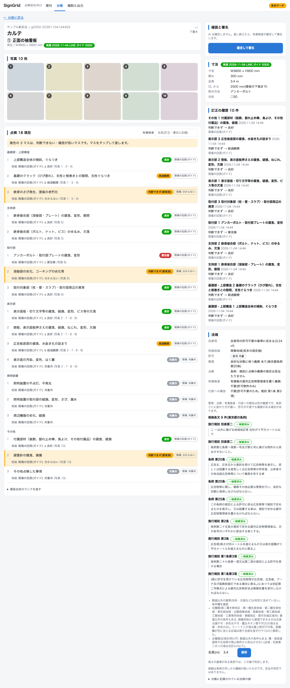

**有資格者: カルテ(黄色は判断できず)**


**事務・営業: 台帳**
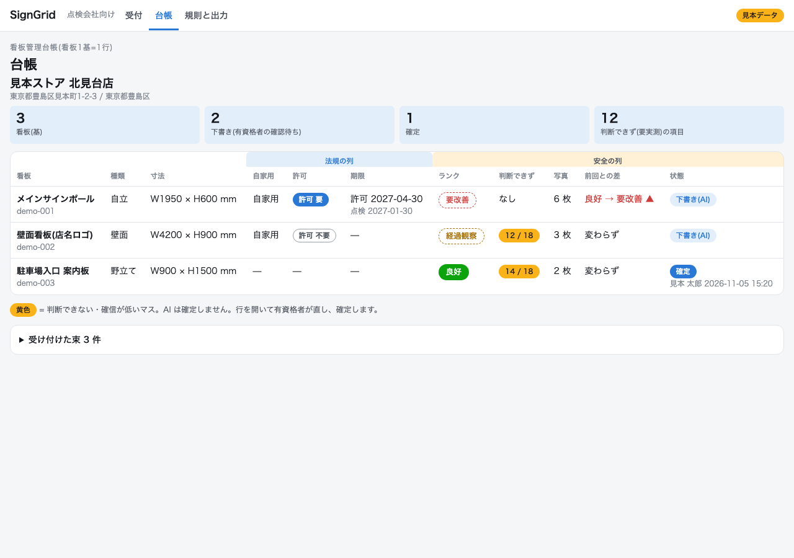

**LINE のガイド付き点検は、全景の次に表示面の正面(各面)を撮り、看板の種類を選ぶ**: 部位ごとの問いに、種類に合わせた撮る場所が 1 行付く(高所に登らせない。傾きは全景で見る)。**寸法の実測は初回だけ**: 台帳にその看板の寸法が無い時、幅・高さ・厚み(任意)・GL(地面から看板の下端まで)・取付方法(一覧か文字)・支柱を聞く。図面があれば「図面で送る」、要らなければ「飛ばす」で通せる。2回目以降は前回の実測を引き継ぎ、聞かない(`docs/LINE.md`)。

### ② 看板の持ち主(`/owner/`)

**さいたま市の条文つき**
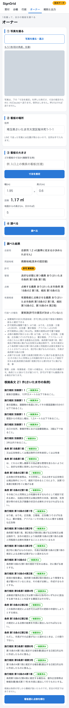

**写真から推定した寸法のまま調べると、推定の範囲の両端で判定する(両端で結論が分かれた項目は「要実測」。欄を手で直すと入力値で判定)**: [owner-judge-range-sp](docs/img/owner-judge-range-sp.png)

### ③ 行政(`/gov/`)

**巡回(スマホ。撮る→送る、送った直後)**
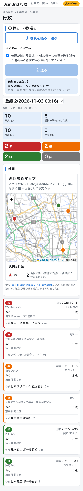

**窓口(PC。一括登録と地図)**
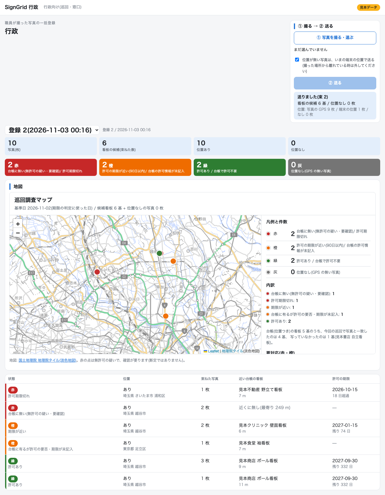

## 3. 知識が育つ工程

ベテランの判断を本人が現場にいるうちに、次の人が受け継げる形にする。**承認だけが次の下書きに効く**(`docs/WORKFLOW.md`、`docs/PIPELINE.md`)。

声・写真 → **AI の下書き** → **有資格者の訂正** → **1問の聞き返し** → **規則の候補** → **承認** → **矛盾の検出** → 次の下書きに効く

| # | 場面 | 画面 |
|---|---|---|
| 1 | AI の下書き。黄色は判断できない・確信が低いマス | 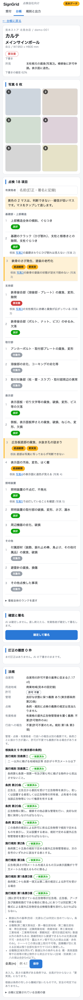 |
| 2 | 「赤錆」とだけ訂正すると、範囲・程度・写真番号を1問だけ聞き返す |  |
| 3 | 答えで、規則が 項目 / 所見 / 条件 / 区分 の形で候補に積まれる | 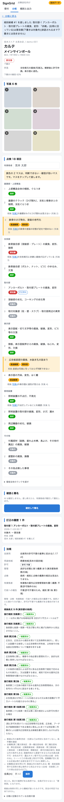 |
| 4 | 同じ条件で別の区分の訂正が入ると、2つの規則を並べて矛盾を知らせる | 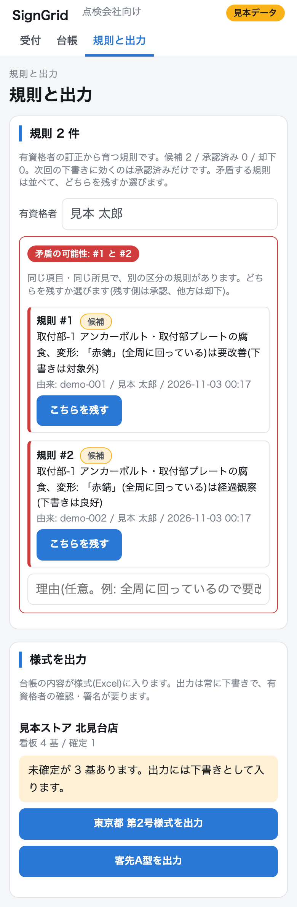 |
| 5 | 候補のままでは次の下書きに効かない | 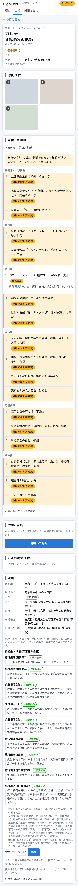 |
| 6 | 「こちらを残す」1操作で、承認と却下、理由と承認者が残る | 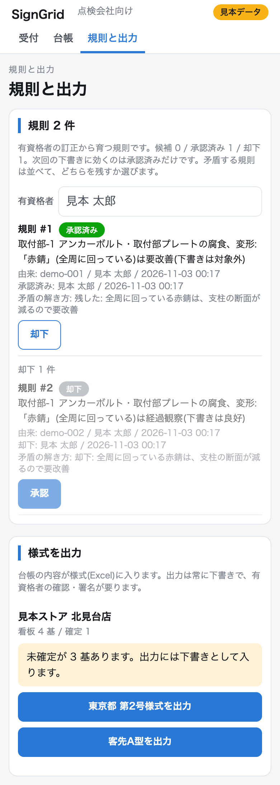 |
| 7 | 承認済みの規則に従って、同じ看板の下書きが変わる | 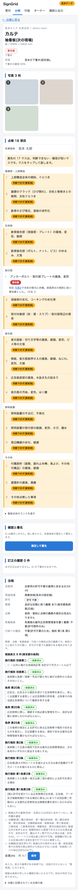 |

- 規則に顧客名・店名は入らない(項目名・所見・条件・区分だけ)。
- 一周は固定値の見本の判定役で通す(API なし)。7 の下書きで他の17項目が黄色なのはそのため。
- **正直な測定**: 承認済み規則 6 本を入れた 102 基の評価は、完全一致 71.6%・±1 99.0% で、規則なしと**同じ**だった(規則が当たる看板が少ない)。規則が効くことは、この測定では示せていない(`docs/PIPELINE.md` §3)。

## 4. 点検(安全)

看板1基を 18 項目 × 3 段階(良好 / 経過観察 / 要改善)で下書きする(東京都 第2号様式の18項目)。ランクは 1 良好〜4 即時対応。見逃し(要対応を「大丈夫」と言う)を最も重く見る(`docs/EVAL.md`)。

**評価(自社の点検記録 829 基。非公開、評価の正解としてのみ参照)** — 全量、写真6枚まで、例示6、規則なし:

| 判定役 | 完全一致 | ±1 以内 | 要対応の見逃し | 誤警報 | 項目一致 | 費用 |
|---|---|---|---|---|---|---|
| 常に 2(定数) | 29.9% | 98.9% | 100.0% | 0.0% | 10.7% | - |
| Sonnet 5.5 | 59.1% | 94.8% | 72.2% | 7.4% | 68.7% | $9.00 |
| Opus 5.5 | 66.5% | 93.8% | 76.7% | 4.9% | 75.8% | $20.95 |

正解は点検者の自己申告で「点検者との一致率」。ランクの偏りが大きい(定数でも約3割当たる)ので、定数と並べて読む。**要対応は4分の3を見逃している**。AI の下書きを人が確定する理由は、ここにある。

**一周の実測(客先の 2026年 1店舗: LINE 写真 1,398 枚 + 手書きの点検票スキャン 140 頁。評価 829 基に入っていない店)**(`docs/FIELD.md`)

| 指標 | 値 |
|---|---|
| 一周(PDF 登録 → 69 基の下書き → 様式出力) | 約 9 分(537 秒)、API $7.44 |
| **現場の一周(LINE のガイド付き点検、実物の看板 2 基、屋外広告士本人、2026-11-05、人の確認込み)** | 位置送信から 2 基目の記録まで **22 分 51 秒**(2 基目は 2 回目の位置送信から 16 分 24 秒= **1 基 約 8 分**)。写真 16 枚、項目 11+7、webhook 82 件 エラー 0、台帳に 2 基(下書き)。API 0(判定は本人、v3 の時点) |
| 手書き点検票の転記の照合(Sonnet 5.5 ↔ Opus 5.5、15 頁) | 判定欄の一致 97/102 = 95.1% |
| 完全一致(47 基、Opus 5.5) | 70.2%(33/47) |
| 要対応の見逃し | **5/9** |
| 誤警報 | 1/38 |
| 黄色(判断できず) | 69 基 × 18 項目のうち 62.5%(昼の写真で見えない項目が大半) |

限界: 1店舗・47 基で、要対応は 9 基(ランク4は 0)。現場の一周は 1 人・2 基・1 回(v3、自動下書き前)の実測で、慣れや看板の数で変わる。例示は同じ店の別の看板。他の店へ一般化した数字ではない。

## 5. 法規(許可・義務)

点検とは別の判断(`docs/LEGAL.md`、`docs/GIS.md`)。

- **4自治体の条例原文から規則を AI が抽出**: 東京都・埼玉県・越谷市・さいたま市(条例と施行規則の8本)。答えには根拠条文(条・項・号と原文の抜粋)が付く。
- **許可の要否**: 要 / 不要 / 要実測の3段階。寸法が分からなければ「要実測」に倒す(保守側)。LINE のガイド付き点検の初回に寸法を実測して台帳に入れると、カルテを開くたびに面積と全高で再判定され、この「要実測」が減る。寸法の出どころはカルテのバッジ(実測 / 推定(AI) / 図面 / 未入力)で分かる。客先 1店舗の 74 基(図面のスケッチから W・H を読んだ場合)では、許可の要実測が 6 基から 3 基に減った(不要 / 要 / 要実測 = 67 / 4 / 3、`docs/FIELD.md`)。
- **用途地域と全高を接続**: 住所 → 国土地理院で座標化 → 国土交通省の用途地域 GIS(埼玉県 58 + 東京都 52 = 110 本、15,783 ポリゴン)で区分を引き、判定に渡す。禁止地域は用途地域だけの暫定(風致・景観・文教などは未判定)。GIS は参考値。
- **4つの義務**: 管理 / 点検 / 有資格者 / 行政への報告を別々に判定する。東京都の有資格者は「有資格の屋外広告物管理者を置く」義務(点検をさせる義務ではない)。24 ケースの表は `python3 tools/duties_matrix.py`(API なし)。
- **限界**: 条例の写しは 2026-10-20 時点。使う前に最新の例規集と突き合わせる。埼玉県の他の市町村は県条例で引き、市独自条例は未確認。

## 6. ハッカソンの後、誰がどう使い続けるか

- **看板製作会社の有資格者と事務**: 客先の点検(紙の点検票とスマホ写真)を、看板1基=1行の台帳とカルテに載せる。有資格者は AI の下書きを確認して確定・署名し、事務は台帳と様式出力(東京都 第2号様式・客先A型)を使う。
- **次回の点検**: 前回測った寸法と、確定した判定が台帳に残り、次回のカルテから参照できる。職人は LINE で写真を送るか、ガイドに沿って撮る。
- **行政向け**: まず巡回の「撮る→送る」から。職員が撮った写真が位置で看板ごとに束ねられ、台帳との突き合わせと地図に出る。
- **看板の持ち主**: QR で開き、許可の要否と義務を条文つきで調べ、点検を依頼する。
- **未実装・将来**: 行政側の本物の許可台帳(許可番号・期限・申請者)との連携は未実装。今は自社の施工台帳で代用している(`docs/GOV.md` の限界)。他の自治体の条例は未対応。
- 見本データで動き、鍵が無くても画面は開く(AI の下書きと寸法の推定だけ鍵が要る)。使い方は Quick start。

## 7. Claude の使い方

| 工程 | モデル |
|---|---|
| 判定の下書き(写真 → 18項目、根拠の文と写真番号、判断できずの理由。構造化出力) | Opus 5.5(全量で Sonnet 5.5 より完全一致・誤警報は良いが、見逃しは同程度に多い) |
| 手書き点検票の転記(画像入力) | Sonnet 5.5。15 頁を Opus 5.5 で照合 |
| 条例原文からの規則抽出(根拠条文つき) | Sonnet 5.5(既定)。4つの義務の再抽出は Opus 5.5 |
| 訂正への聞き返し、答えの構造化 | Sonnet 5.5(1回 約 $0.002〜0.007) |
| 看板の寸法の推定(写真から範囲つき) | Sonnet 5.5 / Opus 5.5。相対誤差の中央値 16.7% / 17.1%(20基、改善は見られず、`docs/EVAL.md`) |
| 実装 | Claude Code が本線。ヘッドレスの実装サブ(`claude -p`)を git worktree で並列に走らせる |

- 評価は定数・正解を渡す判定役と並べ、毎回記録表に1行足す(`docs/EVAL.md`。Fable 5.1 の 102 基の測定も記録)。
- 作業文(企画・絵コンテ・作業表)は期間前に作り、リポジトリの外に置く(運営 FAQ Q4)。コミット履歴は 2026-11-02 12:30 から公開のまま。

## 8. Quick start

Python 3.12 以上。

```
python3 -m venv .venv && .venv/bin/pip install -r requirements.txt && .venv/bin/pip install -e .
kanban-karte ledger import data/sample/ledger.json    # 見本データ(架空の店、3基)を台帳に入れる
kanban-karte ledger list
kanban-karte ledger show demo-001
python3 -m kanban_karte.web                           # 見本データで画面を起動(http://127.0.0.1:8790/)
python3 -m kanban_karte.web --db <sqlite> --sample    # 見本データを入れた台帳で起動
python3 -m kanban_karte.intake.line.cli simulate --guide data/sample/guide_plan.json   # LINE のガイド付き点検を模擬で一周(鍵も LINE も不要)
python3 -m kanban_karte.legal.cli judge --address "東京都豊島区見本町1-2-3" --use self --area 8.5 --height 3.2
python3 -m kanban_karte.output.cli tokyo --from-json data/sample/ledger.json --site demo-site-1 --out out.xlsx
python3 -m kanban_karte.gov.make_sample --db /tmp/gov.sqlite   # 行政の見本(写真10枚・台帳5基)。続きは docs/GOV.md
python3 -m kanban_karte.eval.run_eval --help          # 評価(正解データは非公開。設定は data/private/sources.example.toml、docs/EVAL.md)
python3 -m unittest                                   # テスト(827 件)
```

- 下書き(AI)と寸法の推定は `ANTHROPIC_API_KEY`(環境変数か `.env`)があるときだけ動く。無いときは該当のボタンが無効になる。見本の画面は鍵なしで動く。
- 台帳は SQLite(既定 `data/private/ledger.sqlite`、`--db` で変更)。
- LINE 本番: `docs/LINE.md`(`LINE_CHANNEL_SECRET` と `LINE_CHANNEL_ACCESS_TOKEN`)。

## 9. リポジトリ構成

`kanban_karte/`

| パッケージ | 役割 |
|---|---|
| `ledger/` | 看板管理台帳(SQLite、看板1基=1行)と18項目の定義 |
| `intake/` | 入口。PDF の束、ページ種別、LINE(`intake/line/`: webhook、ガイド付き点検) |
| `ocr/` | macOS 標準の Vision でページ上部を読む(ローカル、外部通信なし) |
| `pipeline/` | 束 → 下書き → 訂正・聞き返し → 規則の承認 → 確定 |
| `eval/` | 評価ハーネス(判定役を差し替えて測る、写真セルの切り出し) |
| `legal/` | 住所 → 自治体、条例から規則の抽出、許可の要否と4義務の判定 |
| `geo/` | 住所の座標化と用途地域(GIS)の引き |
| `dim/` | 写真から看板の寸法を範囲つきで推定 |
| `output/` | 東京都 第2号様式と客先A型の xlsx 出力(常に下書き) |
| `web/` | 画面(標準ライブラリの `http.server` と素の HTML/CSS/JS) |
| `gov/` | 行政の巡回写真の一括登録・台帳との突き合わせ・地図 |
| `impact/` | 自社の看板の「把握の数字」の集計 |

`tools/`: `web_screenshots.py`(画面写真)、`duties_matrix.py`(義務の24ケース)、`field_transcribe.py` / `field_index.py` / `field_run.py`(1店舗の一周)、`seed_eval_rules.py`(規則の効果測定の種)、`eval_jitter.py`、`rule_tune.py`、`make_sample_photos.py`、調査用(`*_probe.py`、`page_dump.py`、`overlay_crops.py`)。

`docs/`

| ファイル | 内容 |
|---|---|
| `EVAL.md` | 評価の設計と日ごとの測定記録 |
| `FIELD.md` | 客先 1店舗の一周の実測 |
| `LEGAL.md` | 法規役、4自治体の義務、24ケース |
| `GIS.md` | 用途地域 GIS の出典と使用許諾 |
| `GOV.md` | 行政の一括登録と地図 |
| `IMPACT.md` | 自社版『把握の数字』 |
| `LINE.md` | LINE 入口とガイド付き点検 |
| `OCR.md` | ページ種別と束ねの OCR |
| `OUTPUT.md` | 様式出力 |
| `PIPELINE.md` | 下書き・確認・確定・規則 |
| `WEB.md` | 画面と API |
| `WORKFLOW.md` | 知識が育つ工程の一周 |

## 10. 持ち込みデータ

**再利用の条件**: コードは公開リポジトリとして公開する(閲覧専用ライセンス、`LICENSE`)。自社の点検記録(829 基の正解)・客先の写真・点検票・ロゴはリポジトリに含めず、再利用できない。見本データ(`data/sample/`)は動作確認用。条例原文と国土交通省の GIS は、下の表の出典と取得時期のとおり。ライセンスは 11 節。

| データ | 取得 | 扱い |
|---|---|---|
| 東京都・埼玉県・越谷市・さいたま市の条例と施行規則(公開例規、原文のテキスト8本、`data/ordinances/`) | 2026-10-20 目安 | 同梱 |
| 国土交通省 都市計画決定GISデータ(用途地域。埼玉県・東京都) | 2026-11-02 | 再配布しない(`data/private/`) |
| 国土交通省 屋外広告物条例ガイドライン(国の技術的助言) | 法規の読みの根拠として参照 | — |
| 国土地理院 住所検索・逆ジオコーダ・市区町村コード表・地理院タイル | 2026-11-02(コード表) | コード表は `data/gsi/`、出典を表示 |
| 自社の点検記録 829 基(正解) | 非公開 | 評価の正解としてのみ参照。リポジトリに入れない。再利用不可 |
| 客先の 2026年 1店舗(LINE 写真 + 点検票スキャン) | 2026-08-31 点検 | 非公開。参照のみ、リポジトリに入れない。再利用不可 |
| 見本データ(`data/sample/`) | — | 動作確認用。すべて架空(店名・住所・日付・判定。写真は無地) |

## 11. 期間中に作った物 / 非公開データ / ライセンス

- 期間前のコードは持ち込んでいない。コードと文書はすべて 2026-11-02 12:30 JST 以降に作った。
- 顧客名・社員名・単価・検算済みの規則・写真・点検票・台帳は入れない。置き場は `data/private/`(未追跡)で、評価データへの参照は `data/private/sources.toml`(未追跡)だけ。
- ライセンス: 閲覧専用(View-Only)。審査・評価のための閲覧と、手元での実行のみ可。再配布・改変版の配布・組み込み・サービス提供・業務利用・AI 学習は不可。全文は `LICENSE`。Copyright (c) 2026 株式会社エフ広芸。

## English summary

SignGrid ("karte" = a per-sign record) puts the inspection and legal checks that signboard makers' qualified inspectors run on paper and phone photos into a one-sign-per-row ledger. Built from scratch during Built with Claude: Japan 2026 (started 2026-11-02 12:30 JST). **A person confirms**: AI only drafts; a qualified person (outdoor-advertising specialist) confirms and signs, and the photo numbers and ordinance articles behind each fact stay on screen.

- **Three entrances, six screens**: (1) inspection company `/`: LINE (photos, or guided inspection incl. an optional, skippable sign-measuring step on the first visit; later visits reuse it), web karte (qualified inspector confirms and signs), PC (intake, ledger, rules, xlsx output); (2) sign owner `/owner/` on a phone (permit and duties by ordinance, via QR); (3) government `/gov/`: patrol on a phone (shoot and send; photos bundled by GPS) and the desk on PC (batch photos on a map).
- **Knowledge grows by a process**: AI draft, inspector correction, one follow-up question, rule candidate, approval (only approved rules affect later drafts), conflict detection. A measured effect of 6 approved rules on the draft was none (`docs/PIPELINE.md`).
- **Inspection**: 18 items x 3 grades drafted by Opus 5.5. On our own 829 inspected signs (private, ground truth only), exact match 66.5%, misses 76.7% of signs needing action, 4.9% false alarms. On a real 2026 store (47 signs): 70.2% exact, 5/9 misses, 1/38 false alarms; a full lap took about 9 minutes.
- **Law**: rules extracted by AI from the original text of 4 ordinances (Tokyo, Saitama, Koshigaya, Saitama City), joined with zoning GIS and height, and four separate duties (maintain, inspect, qualified person, report). Measuring a sign on site cuts "needs measuring" results. Reference values only; check against current law.
- **After the hackathon**: qualified inspectors and office staff at signboard makers load customer inspections into the ledger and karte, and carry sizes and judgments to the next visit; government starts from shoot-and-send. Integration with a real permit ledger is not implemented (future).
- **Data**: our own inspection records (ground truth), customer photos, forms and logos are not in this repository and may not be reused; `data/sample/` is fictional, for demos. Code is public under a view-only license (see `LICENSE`): viewing, cloning and running locally for evaluation only; no redistribution, modified distribution, integration, hosting, business use or AI training. **How built**: Claude Code as the main line, headless `claude -p` sub-agents in parallel git worktrees; commit history is public from the start.
- Quick start: section 8. License: view-only, see `LICENSE`.
