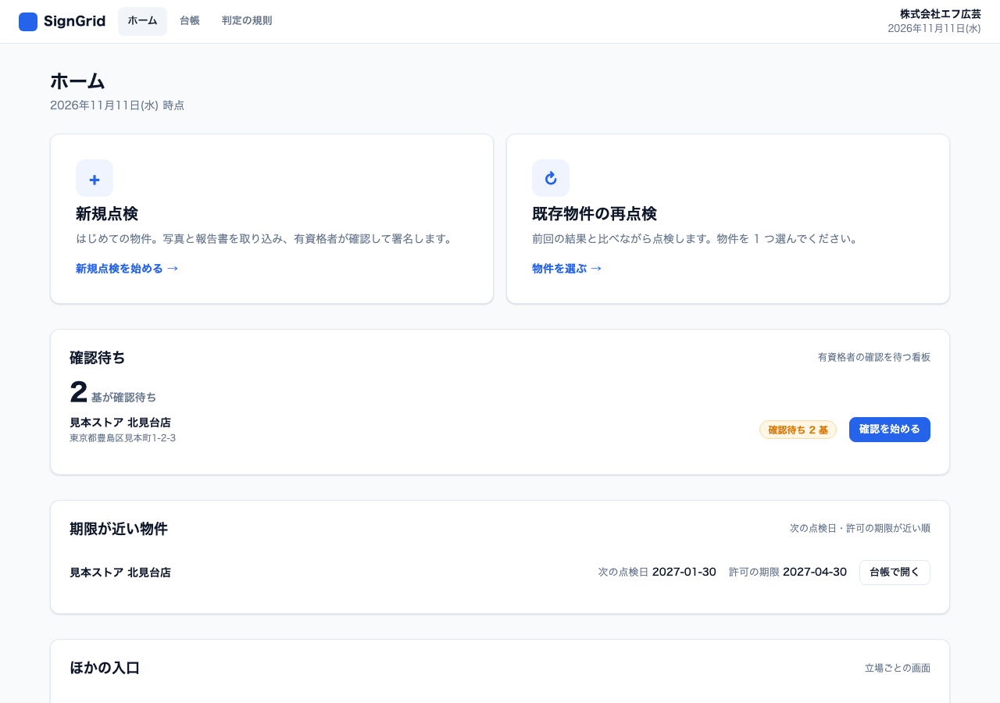
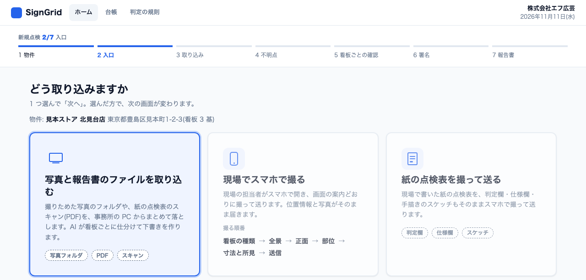
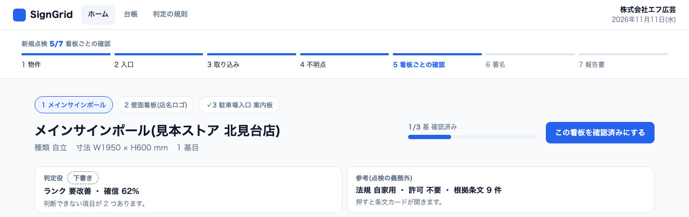
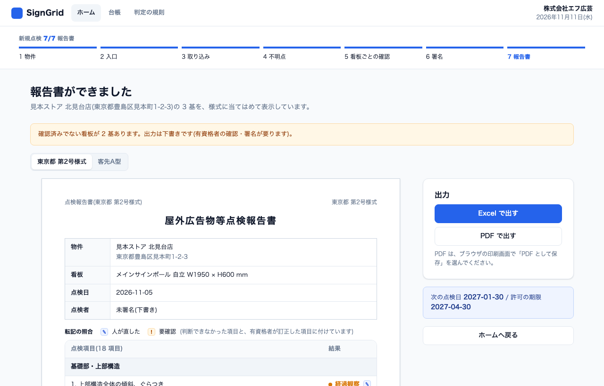
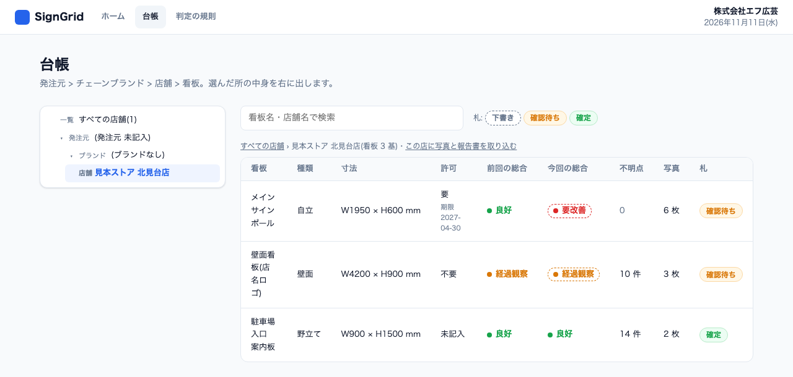
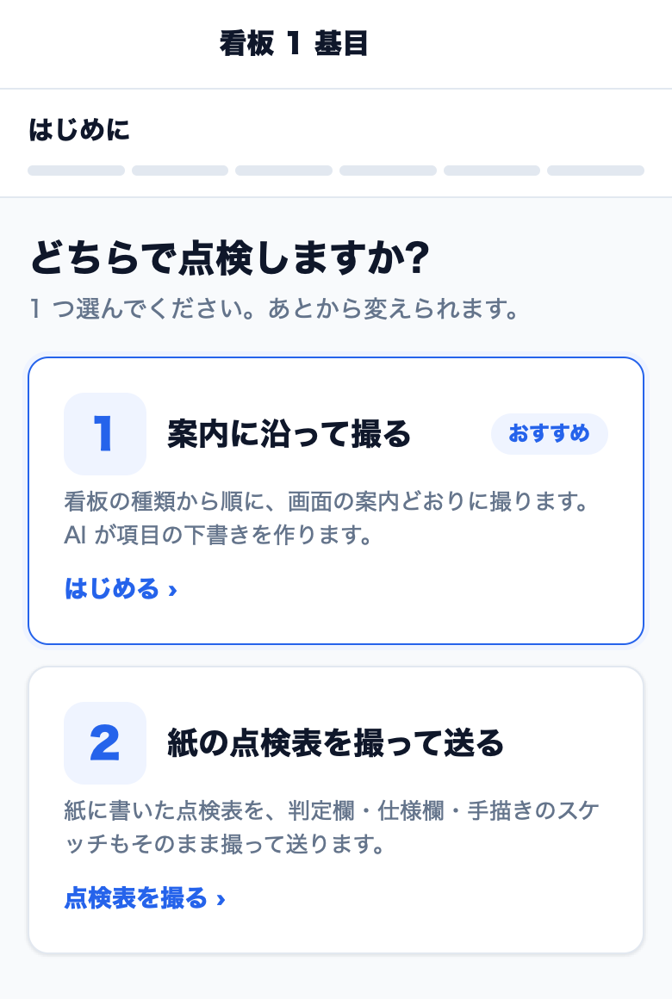
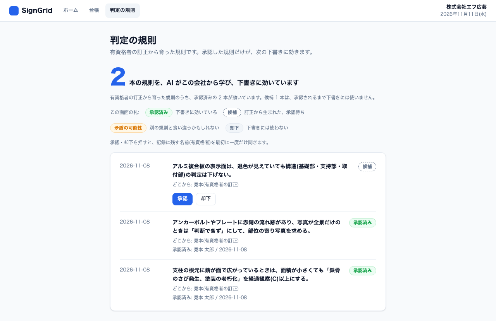
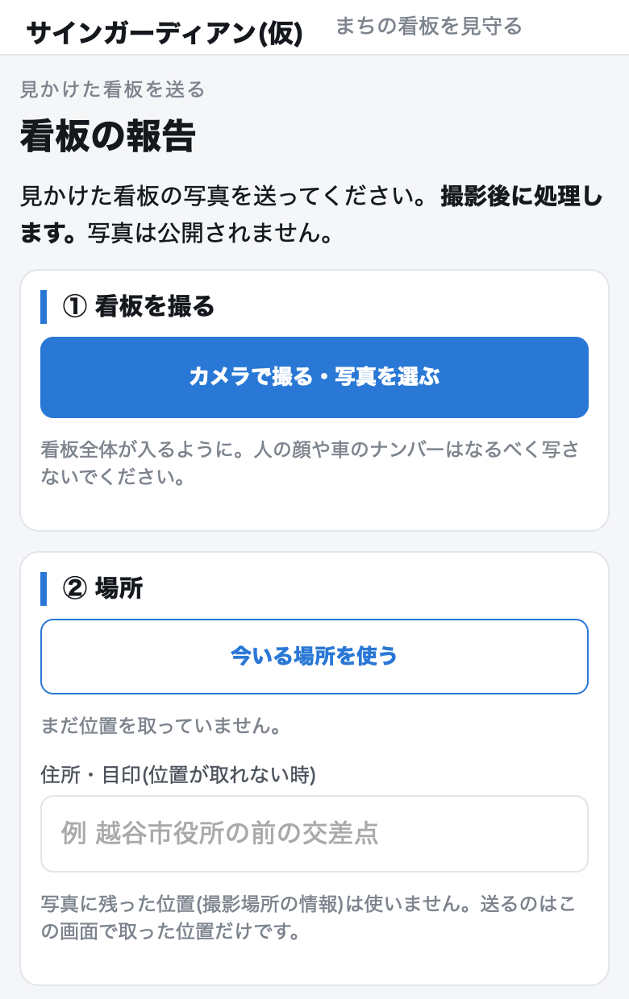

# SignGrid(サイングリッド)

**SignGridは、全国で発生している看板落下事故を少しでも減らすことを目的に開発した、看板の点検と法規確認を一つにまとめるAI駆動の統合ソリューションです。**

看板事故の8割は行政が把握できていない看板で発生しています。全国的な課題である屋外広告物の安全管理問題を解決するため、看板を持つ企業の保守管理コストをAIによる省力化でさげ、多くの企業が安全対策に取り組めるようにする試みです。

看板の設置は原則、一部を除き許可申請が必要ですが、申請は2〜4割に留まる他、不要の看板は安全管理の義務はありながら台帳にはないため、私たち看板設置会社が点検を働きかけるしかありません。しかし看板は規格品が少なく、点検には広い技術と経験が要り、作業も大掛かりで、費用を出せる企業は限られます。そこで知識や経験、事務作業をAIで効率化し、コストダウンを目指しました。

職人がスマホの案内に沿って写真を撮ると、Claudeが管轄行政を特定し適法性を照合、さらに看板のサイズや必要な点検項目を学習に基づいて埋めていきます。報告書のスキャンにも対応。AIは下書きまでで、最終判定と署名は有資格者が担います。従来1ラウンド80時間の登録〜報告書出力が、271基の実測で約8分になりました。地元越谷市の声を受け、行政や市民が写真で通報し、把握外の看板を台帳に載せる入口も作りました。

- **デモ動画**(3 分・日本語): https://youtu.be/S9r0nuLufuY
- **公開デモ**(見本データ・架空の店、見る側に鍵は不要): https://signgrid.srv1601539.hstgr.cloud
- [English summary](#english-summary)

Built with Claude: Japan 2026 の提出作品です(開発開始 2026-11-02 12:30 JST。期間中にゼロから作りました)。上の 3 段落は、提出した概要の文面です。提出時点の版はタグ `hackathon-submission-2026-11-08` で見られます。

**目次**: [1. 課題](#1-課題-屋外広告物の安全管理) / [2. なぜ点検が進まないか](#2-なぜ点検が進まないか-保守管理コスト) / [3. SignGrid がやること](#3-signgrid-がやること) / [4. 行政と市民の入口](#4-行政と市民の入口) / [5. Claude の使い方](#5-claude-の使い方) / [6. ハッカソンの後](#6-ハッカソンの後誰がどう使い続けるか) / [7. Quick start](#7-quick-start) / [8. リポジトリ構成](#8-リポジトリ構成) / [9. 持ち込みデータ](#9-持ち込みデータ) / [10. ライセンスほか](#10-期間中に作った物--非公開データ--ライセンス)

## 1. 課題: 屋外広告物の安全管理

街の看板は、誰かが管理している。そう思いますよね。実は違います。**看板の落下事故の 8 割は、行政が把握していない看板でした。**

- 国土交通省に報告のあった看板の落下事故 89 件(2021-04〜2024-12)のうち、許可の要らない自家用 43 件+無許可 30 件 = 73 件(約 8 割)が行政の把握の外でした(沼田ほか、日本建築学会計画系論文集 第 91 巻 第 845 号、2026-07。母データの国への報告書は非公開)。
- 北海道の 6 自治体の落下等事故 25 件(2014 年度以降)は、許可不要 12・無許可 9・許可あり 4 でした(総務省 北海道管区行政評価局、2017-11)。

看板には、場所や大きさによって行政への申請が要るものと、要らないものがあります。**申請が要るものでも 6 割以上が申請されておらず、点検されているかどうか、誰にも分からない状態です。**

- 福岡市: 表示面 10㎡以上の 12,154 件のうち無許可が 7,798 件(約 65%)(福岡市「参考資料3 無許可広告物是正のこれまでの取組み状況について」)。
- 横須賀市: 郊外の沿線で申請が要る 634 件のうち未申請が 519 件(82%)(横須賀市 景観審議会 平成 29 年度資料)。

札幌の事故(下の表の 2015 年)を機に、国は点検の義務化を各自治体に促しましたが、実効性は十分ではありません。**申請の要らない看板にも安全管理の義務はありますが、台帳にはありません。** だから、私たち看板設置会社が点検を働きかけるしかありません。

- 埼玉県は許可不要の看板にも点検の義務(3 年ごと)があり、越谷市・さいたま市は点検と有資格者の義務があります(`docs/LEGAL.md` の 24 ケース表)。
- 行政への報告は許可の申請・更新の時だけです。

**公的資料で裏の取れた落下事故**(すべて 2026-11-04 に原典を確認)

| 年月日 | 場所 | 何が起きたか | 被害 | 出典 |
|---|---|---|---|---|
| 1997-06-20 | 東京都渋谷区 センター街入口 | 旧アーケード看板(約 4 トン)が台風の強風で倒壊。所有者は点検の案内を受けていたが放置 | 死亡 1 | 屋外広告物適正化推進委員会「オーナーさんのための看板の安全管理ガイドブック」2024-06 |
| 2007-06 | 東京都新宿区 | 雑居ビル 1 階の飲食店の看板(1.5m×5m)が落下 | 重傷 1(骨盤骨折)・軽傷 1 | 同ガイドブック / 京都市「広告板等の落下物対策について」 |
| 2015-02-15 | 札幌市中央区 | 高さ約 15m の突出看板の一部が歩道の女性に直撃。取付部の腐食+強風。30 年間、目視のみの点検 | 重体 1 | 国土交通省「広告板落下事故の概要」/ 総務省 北海道管区行政評価局 実態調査(2017-11) |
| 2017-04-10 | 北海道帯広市 | 許可を受けていた地上看板(設置 44 年)の表示面が市道に落下 | なし(許可があっても落ちる例) | 総務省 同調査 |
| 2018-10-29 | 北海道内 | 店舗外壁の金属看板(2.4m×1.2m)が落下。固定の釘が腐食 | 重傷 1 | 国土交通省 建築物等事故・災害対策部会 資料 |
| 2024-07-24 | 埼玉県川口市 | 雑居ビル 2 階の飲食店の看板が強風で落下。許可の要らない看板で、錆が目立っていた | 重傷 1 | 川口市 / 埼玉県議会 2025-03-04 答弁 |

確認できた死亡は 1997 年の渋谷が最後です。国土交通省の建築物事故の「看板」区分(2010-12〜2022-11)は 15 件・被害者 10 人・死亡 0 でした。8 割の 89 件(落ちた看板)と、6 割以上(申請の実態調査)は別の調べ方の数字なので、混ぜて読まないでください。

## 2. なぜ点検が進まないか: 保守管理コスト

点検は、看板 1 基ごとに目視や打音で十数項目を診て、有資格者が自治体ごとに違う書式で報告書にします。ある顧客の 45 店舗では、事務作業だけで 80 時間かかりました。

看板は規格品が少なく、点検には広い技術と経験が要ります。作業も大掛かりで、費用を出せる企業は限られます。実態を把握する仕組みがなく、看板所有者の負担が重い。ここを AI で変えられないかと考えました。

**点検と事務の手間が減ればコストが下がり、看板所有者は点検を頼みやすくなります。点検される看板が増えるほど、把握されない看板は減っていきます。**

## 3. SignGrid がやること

1. **職人がスマホの案内に沿って写真を撮ります。** 看板の種類 → 全景 → 正面 → 部位 → 寸法と所見 → 送信 の順です(`/v3/field/`)。位置情報と写真がそのまま届きます。
2. **Claude が下書きを埋めます。** 看板 1 基を 18 項目で下書きし、看板のサイズを写真から範囲つきで推定します。管轄行政を特定し、許可の要否と 4 つの義務(適法性)を条文つきで照合します。
3. **報告書のスキャンにも対応します。** 撮りためた写真のフォルダや、紙の点検表のスキャン(PDF)を、事務所の PC からまとめて取り込みます。AI が看板ごとに仕分けて下書きを作ります。
4. **最終判定と署名は有資格者が担います。** AI が出すのは下書きだけです。有資格者(屋外広告士)が「判断できず」の項目を確かめ、違う所を直し、看板ごとに確認済みにして署名します。項目には根拠の写真が、法規には根拠条文が付きます。
5. **報告書を出力します。** 管轄行政の書類形式に合わせて、Excel と PDF で出します(現在は東京都 第2号様式と、客先提出用の書式の 2 種類。対応する自治体は順に増やします)。

**従来 1 ラウンド 80 時間の登録〜報告書出力が、271 基の実測で約 8 分になりました。**

| 指標 | 値 |
|---|---|
| 1 ラウンド(別の客先の 32 店舗 271 基。Excel 貼付の写真 1,279 枚 → 下書き → 客先提出用の書式 xlsx 32 本、2026-11-08) | **7 分 52 秒**(472 秒: 登録 0.8 / 下書き 460.3 / 出力 11.3)、Sonnet 5.5、4 並列、API $6.18。同じ客先の 1 ラウンド(45 店舗)の事務作業は 80 時間(自社の記録、2026-07)。判定の質は未測定(写真は Excel 貼付の縮小版) |
| 一周(PDF 登録 → 69 基の下書き → 様式出力) | 約 9 分(537 秒)、API $7.44 |
| 手書き報告書の転記の照合(Sonnet 5.5 ↔ Opus 5.5、15 頁) | 判定欄の一致 97/102 = 95.1% |
| 完全一致(47 基、Opus 5.5) | 70.2%(33/47) |
| 要対応の見逃し | **5/9** |
| 誤警報 | 1/38 |
| 判断できず | 69 基 × 18 項目のうち 62.5%(昼の写真で見えない項目が大半) |

- 約 8 分は、登録・下書き・出力にかかった機械の時間です。有資格者の確認と署名の時間は含みません。この 271 基では判定の質は未測定です(写真は Excel 貼付の縮小版)。
- 限界: 精度の実測は 1 店舗・47 基で、要対応は 9 基(ランク 4 は 0)です。例示は同じ店の別の看板です。他の店へ一般化した数字ではありません(`docs/FIELD.md`)。
- 概要の「Claude が管轄行政を特定し適法性を照合」の内訳: 管轄の特定は住所と位置から地図データ(国土地理院、国土交通省の用途地域 GIS)で行います。適法性の規則は、Claude が 4 自治体の条例原文から根拠条文つきで抽出したものです(3.4)。

### 3.1 画面

公開デモ(見本データ・架空の店)のトップから、次の画面にたどり着けます。

| 使う人 | 画面 | 何をするか |
|---|---|---|
| 看板設置会社(事務所の PC) | ホーム(`/v3/`) | 新規点検、既存物件の再点検、確認待ちの看板、期限が近い物件 |
| | 新規点検(7 段階) | 物件 → 入口 → 取り込み → 不明点 → 看板ごとの確認 → 署名 → 報告書 |
| | 台帳 | 発注元 > チェーンブランド > 店舗 > 看板。前回と今回の総合、許可、不明点の数 |
| | 判定の規則 | 有資格者の訂正から育った規則の承認・却下(3.2) |
| 職人(現場のスマホ) | 現場のスマホ画面(`/v3/field/`) | 案内に沿って撮る。紙の点検表を撮って送ることもできます |
| 看板所有者 | `/owner/` | 写真と住所から、許可の要否と点検まわりの 4 義務を条文つきで調べる |
| 行政 | `/gov/` | 巡回の写真を位置で束ね、台帳と突き合わせて地図に出す(4 章) |
| 市民 | サインガーディアン(仮)(`/report/`) | 見かけた看板の写真と位置を送る(4 章) |

- 台帳と API は入口で共通です。行政の画面から看板設置会社の画面へは入れません(別の組織)。
- 公開デモの画面は提出時点のままで、画面上の表記は「看板の持ち主」などです。この README の「看板所有者」と同じ対象です。

**看板設置会社(`/v3/`)**: 提出時点の公開デモの画面です。

<table>
<tr>
<td align="center" valign="top" width="50%"><a href="docs/img/readme/v3-home-pc.png"></a><br><sub>ホーム: 新規点検、再点検、確認待ち、期限が近い物件</sub></td>
<td align="center" valign="top" width="50%"><a href="docs/img/readme/v3-entrance-pc.png"></a><br><sub>入口: ファイルを取り込む / 現場でスマホで撮る / 紙の点検表を撮って送る</sub></td>
</tr>
<tr>
<td align="center" valign="top" width="50%"><a href="docs/img/readme/v3-check-pc.png"></a><br><sub>看板ごとの確認(画面の上部): AI の下書き(ランクと確信)と、法規の参考(許可の要否・根拠条文)。この下に写真と 18 項目が並びます</sub></td>
<td align="center" valign="top" width="50%"><a href="docs/img/readme/v3-report-pc.png"></a><br><sub>報告書: 東京都 第2号様式 / 客先提出用の書式。Excel と PDF で出す</sub></td>
</tr>
<tr>
<td align="center" valign="top" width="50%"><a href="docs/img/readme/v3-ledger-pc.png"></a><br><sub>台帳: 看板 1 基 = 1 行。前回と今回の総合を並べる</sub></td>
<td align="center" valign="top" width="50%"><a href="docs/img/readme/v3-field-sp.png"></a><br><sub>現場のスマホ画面: 案内に沿って撮る / 紙の点検表を撮って送る</sub></td>
</tr>
</table>

**看板所有者(`/owner/`)**: QR で開き、写真と住所から、許可の要否と点検まわりの 4 義務を条文つきで調べます。

<table>
<tr>
<td align="center" valign="top"><a href="docs/img/owner-saitama-sp.png"></a><br><sub>さいたま市の条文つき</sub></td>
</tr>
</table>

写真から推定した寸法のまま調べると、推定の範囲の両端で判定します。両端で結論が分かれた項目は「要実測」と出ます(欄を手で直すと入力値で判定します): [owner-judge-range-sp](docs/img/owner-judge-range-sp.png)

### 3.2 知識が育つ工程

Claude が作成したドラフトを有資格者が確認し、修正をフィードバックします。この繰り返しで、熟練のプロの知識と判断が、システムの中に蓄積されていきます。**有資格者が承認した規則が、次の点検から効きます**(`docs/WORKFLOW.md`、`docs/PIPELINE.md`)。

写真 → **AI の下書き** → **有資格者の訂正**(「違う」を押す) → **1問の聞き返し** → **規則の候補** → **承認** → 次の下書きに効く

<a href="docs/img/readme/v3-rules-pc.png"></a>

「判定の規則」の画面では、訂正から生まれた候補を承認・却下します。別の規則と食い違うかもしれない規則には「矛盾の可能性」の札が付きます。

- 規則に顧客名・店名は入りません(項目名・所見・条件・区分だけ)。
- **正直な測定**: 承認済み規則 6 本を入れた 102 基の評価は、完全一致 71.6%・±1 99.0% で、規則なしと**同じ**でした(規則が当たる看板が少ない)。規則が効くことは、この測定では示せていません(`docs/PIPELINE.md` §3)。

### 3.3 点検の下書きの精度

看板 1 基を 18 項目 × 3 段階(良好 / 経過観察 / 要改善)で下書きします(東京都 第2号様式の 18 項目)。ランクは 1 良好〜4 即時対応です。見逃し(要対応を「大丈夫」と言う)を最も重く見ます(`docs/EVAL.md`)。

**評価(自社の点検記録 829 基。非公開、評価の正解としてのみ参照)**: 全量、写真 6 枚まで、例示 6、規則なし。

| 判定役 | 完全一致 | ±1 以内 | 要対応の見逃し | 誤警報 | 項目一致 |
|---|---|---|---|---|---|
| 常に 2(定数) | 29.9% | 98.9% | 100.0% | 0.0% | 10.7% |
| Sonnet 5.5 | 59.1% | 94.8% | 72.2% | 7.4% | 68.7% |
| Opus 5.5 | 66.5% | 93.8% | 76.7% | 4.9% | 75.8% |

正解は点検者の自己申告なので、これは「点検者との一致率」です。ランクの偏りが大きい(定数でも約 3 割当たる)ので、定数と並べて読んでください。**要対応は 4 分の 3 を見逃しています。** AI の下書きを人が確定する理由は、ここにあります。

### 3.4 法規(許可・義務)

点検とは別の判断です(`docs/LEGAL.md`、`docs/GIS.md`)。

- **4 自治体の条例原文から規則を AI が抽出**: 東京都・埼玉県・越谷市・さいたま市(条例と施行規則の 8 本)。答えには根拠条文(条・項・号と原文の抜粋)が付きます。
- **許可の要否**: 要 / 不要 / 要実測の 3 段階です。寸法が分からなければ「要実測」に倒します(保守側)。現場で寸法を実測して台帳に入れると、面積と全高で再判定され、「要実測」が減ります。客先 1 店舗の 74 基(図面のスケッチから W・H を読んだ場合)では、許可の要実測が 6 基から 3 基に減りました(不要 / 要 / 要実測 = 67 / 4 / 3、`docs/FIELD.md`)。
- **用途地域と全高を接続**: 住所 → 国土地理院で座標化 → 国土交通省の用途地域 GIS(埼玉県 58 + 東京都 52 = 110 本、15,783 ポリゴン)で区分を引き、判定に渡します。禁止地域は用途地域だけの暫定です(風致・景観・文教などは未判定)。GIS は参考値です。
- **4 つの義務**: 管理 / 点検 / 有資格者 / 行政への報告を別々に判定します。東京都の有資格者は「有資格の屋外広告物管理者を置く」義務です(点検をさせる義務ではありません)。24 ケースの表は `python3 tools/duties_matrix.py` で出せます(API なし)。
- **限界**: 条例の写しは 2026-10-20 時点です。使う前に最新の例規集と突き合わせてください。埼玉県の他の市町村は県条例で引き、市独自条例は未確認です。

## 4. 行政と市民の入口

越谷市 都市計画課にヒアリングを行い、文書で回答をいただきました(2026-11-06)。行政と市民の入口は、この回答を受けて作りました。

- **市が把握できる看板**: 「市で把握している看板は、越谷市屋外広告物条例に基づく許可申請を経て設置された屋外広告物が中心となります。一方で、許可不要の範囲の広告物や無許可で設置された看板については把握がしづらい状況です。」
- **危険な看板が市に伝わる経路**: 「危険な看板に関しては、市民からの電話での通報が最も多いです。」
- **最も手間がかかる所**: 「最も手間がかかるのは、所有者の連絡先特定と連絡がつきにくい場合の対応です。特に許可申請の必要が無い看板や許可申請がされていない看板においては調査に時間を要します。」
- **写真と位置が一緒に届くと**: 「写真と正確な位置情報が一緒に届くことで、迅速かつ的確な現地確認が可能となり、対応の効率化に繋がる可能性があると考えます。」
- **気をつける点**: 「手軽に通報できるメリットがある一方で、誤通報の増加により、職員の事務負担が増加する恐れがあるため、実施方法の工夫は必要と考えます。」
- **行政向けの画面の前提**: 「個人情報を外部に出さず、行政のみ閲覧できることが前提となります」
- **最後の一言**: 「市民の方々に被害が及ぶ危険性がある広告物をピンポイントで早期発見できる仕組みがあれば、市として迅速な対応に繋がるのではないかと考えます。」

越谷市都市計画課にご協力いただきました。

これを受けて、行政の担当者や市民が写真で通報し、把握外の看板を台帳に載せる入口も作りました(試作)。スマホで撮った 1 枚から、看板の安全と法令の目安が分かる入口です。**見つけるのは市民、確かめるのは有資格者です。** 市民には判定を見せません。送られた看板は、SignGrid の台帳(点検の記録+市民の報告)と突き合わせ、まだ記録のない看板なら有資格者が確かめに行きます。

### 4.1 行政(`/gov/`)

- **巡回の職員(スマホ)**: 「撮る→送る」。写真の EXIF GPS(無ければ端末の現在地)で看板ごとに束ね、台帳との一致候補と地図に出します。
- **窓口(PC)**: 一括登録と地図。地図には「未申請の疑い・許可期限切れ / 期限が近い・許可情報が未記入 / 許可あり / 位置なし」で出します(`docs/GOV.md`)。

<table>
<tr>
<td align="center" valign="top" width="36%"><a href="docs/img/gov-capture-sp.png"></a><br><sub>巡回(スマホ。撮る→送る、送った直後)</sub></td>
<td align="center" valign="top" width="64%"><a href="docs/img/gov-capture-pc.png"></a><br><sub>窓口(PC。一括登録と地図)</sub></td>
</tr>
</table>

行政の許可情報(許可番号・期限・申請者)とはつながっていません。許可の申請・許可の情報は行政の中だけで管理される物なので、SignGrid には入れません。行政向けの画面は行政の端末で動かす前提です。この試作を持って、行政への提案を始めています(2026-11-05)。

### 4.2 市民: サインガーディアン(仮)(`/report/`)

市民が見かけた看板を送る入口です。公開デモでの呼び名は「サインガーディアン(仮)」です。

<a href="docs/img/readme/v3-report-citizen-sp.png"></a>

**今ある物(見本データで動きます)**

- ログイン不要です。写真(カメラ)+位置(ブラウザ。無ければ住所)+気になる所+一言(200 字まで)を送ります。名前・連絡先は聞きません。
- 受付番号を返し、`/report/status` で状態と受付日だけが見られます。返す文は「この仕組みの台帳にはまだ無い看板でした。あなたの報告で初めて記録されました。有資格者が、どの看板か確かめます。」などです。危ない・無許可の疑いといった判断は市民に見せません。
- 写真は公開しません。保存時に長辺 1600px に縮め、EXIF(撮影位置を含む)を消します。地図に出す位置は小数 3 桁に丸めます。
- `/gov/` に「市民からの報告」の層があります。丸めた位置・状態・受付日だけを出し、30m 以内の台帳の看板と突き合わせて、記録あり / まだ記録なし / 報告後に点検済み を分けます。
- 送信の上限があります(1 つの接続元から 1 時間 20 件、写真 8MB まで、JPEG / PNG / WebP)。

**まだ無い物(提出版では作っていません)**

- 行政の許可情報との突き合わせ(4.1 のとおり、SignGrid には入れません)。
- 受けて直す側の運用(誰が、何日以内に確かめるか)。
- 取り下げ、職員の手による状態の変更、同じ看板の報告のまとめ、住所 → 位置の変換、保存期間の決め。
- 上限の記録はサーバのメモリ上だけです。受付番号を知っていれば誰でも状態が見えます(状態と受付日だけ)。
- 呼び名の確定(「サインガーディアン」は仮の名前で、商標を確かめてから決めます)。

### 4.3 先行事例と、通報する人のメリット

- 市民の通報は各地で続いています(FixMyStreet 2007-、ちばレポ 2014-、北海道「屋外広告セーフティホットライン」2015- など)。
- 看板の安全に絞った、市民のスマホ通報は、今回の検索(日本・米国・英国・ドイツ語圏の公式ページ)では見つかりませんでした。存在しないとは言いません。
- 続く条件は 5 つと読みました: ①結果が返る ②本人の得がある ③受けて直す側がいる ④何を公開するかの線がはっきりしている ⑤入口を絞って質を保つ。
- 現金の報奨は付けません。報いは「結果が返る」ことです(受付番号で状態が見られます)。

事例の表と根拠は [`docs/CITIZEN.md`](docs/CITIZEN.md) にまとめました。

## 5. Claude の使い方

| 工程 | モデル |
|---|---|
| 判定の下書き(写真 → 18項目、根拠の文と写真番号、判断できずの理由。構造化出力) | Opus 5.5(全量で Sonnet 5.5 より完全一致・誤警報は良いが、見逃しは同程度に多い) |
| 手書き報告書の転記(画像入力) | Sonnet 5.5。15 頁を Opus 5.5 で照合 |
| 条例原文からの規則抽出(根拠条文つき) | Sonnet 5.5(既定)。4つの義務の再抽出は Opus 5.5 |
| 訂正への聞き返し、答えの構造化 | Sonnet 5.5(1回 約 $0.002〜0.007) |
| 看板の寸法の推定(写真から範囲つき) | Sonnet 5.5 / Opus 5.5。相対誤差の中央値 16.7% / 17.1%(20基、改善は見られず、`docs/EVAL.md`) |
| 実装 | Claude Code が本線。ヘッドレスの実装サブ(`claude -p`)を git worktree で並列に走らせる |

- 評価は定数・正解を渡す判定役と並べ、毎回記録表に 1 行足しています(`docs/EVAL.md`。Fable 5.1 の 102 基の測定も記録)。
- **Claude を使わない所**: 実行時の許可の要否と義務の判定は、抽出して人が確かめた規則と地図データで行います。判定の確定と署名は有資格者が行います。
- 作業文(企画・絵コンテ・作業表)は期間前に作り、リポジトリの外に置いています(運営 FAQ Q4)。コミット履歴は 2026-11-02 12:30 から公開のままです。

## 6. ハッカソンの後、誰がどう使い続けるか

- **看板設置会社の有資格者と事務**: 客先の点検(紙の報告書とスマホ写真)を、看板 1 基 = 1 行の台帳に載せます。有資格者は AI の下書きを確認して確定・署名し、事務は台帳と様式出力(東京都 第2号様式・客先提出用の書式)を使います。
- **次回の点検**: 前回測った寸法と、確定した判定が台帳に残り、次回の点検で前回と比べられます。職人は現場のスマホ画面の案内に沿って撮ります。
- **看板所有者**: QR で開き、許可の要否と義務を条文つきで調べ、点検を依頼します。
- **行政と市民**: 巡回の「撮る→送る」と地図、市民の通報の入口は、提案する試作です(4 章)。
- **未実装・将来**: 行政の許可情報は SignGrid に入れません。`/gov/` の突き合わせは、自社の施工台帳と市民の報告に対して行います(`docs/GOV.md` の限界)。他の自治体の条例は未対応です。

## 7. Quick start

Python 3.12 以上。

```
python3 -m venv .venv && .venv/bin/pip install -r requirements.txt && .venv/bin/pip install -e .
kanban-karte ledger import data/sample/ledger.json    # 見本データ(架空の店、3基)を台帳に入れる
kanban-karte ledger list
kanban-karte ledger show demo-001
python3 -m kanban_karte.web                           # 見本データで画面を起動(http://127.0.0.1:8790/)
python3 -m kanban_karte.web --db <sqlite> --sample    # 見本データを入れた台帳で起動
python3 -m kanban_karte.legal.cli judge --address "東京都豊島区見本町1-2-3" --use self --area 8.5 --height 3.2
python3 -m kanban_karte.output.cli tokyo --from-json data/sample/ledger.json --site demo-site-1 --out out.xlsx
python3 -m kanban_karte.gov.make_sample --db /tmp/gov.sqlite   # 行政の見本(写真10枚・台帳5基)。続きは docs/GOV.md
python3 -m kanban_karte.eval.run_eval --help          # 評価(正解データは非公開。設定は data/private/sources.example.toml、docs/EVAL.md)
python3 -m unittest                                   # テスト(919 件)
```

- 下書き(AI)と寸法の推定は `ANTHROPIC_API_KEY`(環境変数か `.env`)があるときだけ動きます。無いときは該当のボタンが無効になります。見本の画面は鍵なしで動きます。
- 台帳は SQLite です(既定 `data/private/ledger.sqlite`、`--db` で変更)。
- 公開デモは審査のための閲覧用で、AI の下書きと寸法の推定も動きます(鍵はサーバ側に設定済み)。トップ(`/`)から、現場のスマホ画面・看板所有者・行政・市民の各画面へ進めます。有資格者のアノテーションの画面 `/expert/` は、トップにリンクが無いので URL を直接開きます。

## 8. リポジトリ構成

`kanban_karte/`

| パッケージ | 役割 |
|---|---|
| `ledger/` | 看板管理台帳(SQLite、看板1基=1行)と18項目の定義 |
| `intake/` | 入口。PDF の束、ページ種別、LINE(`intake/line/`: webhook、ガイド付き点検) |
| `ocr/` | macOS 標準の Vision でページ上部を読む(ローカル、外部通信なし) |
| `pipeline/` | 束 → 下書き → 訂正・聞き返し → 規則の承認 → 確定 |
| `eval/` | 評価ハーネス(判定役を差し替えて測る、写真セルの切り出し) |
| `legal/` | 住所 → 自治体、条例から規則の抽出、許可の要否と4義務の判定 |
| `geo/` | 住所の座標化と用途地域(GIS)の引き |
| `dim/` | 写真から看板の寸法を範囲つきで推定 |
| `output/` | 東京都 第2号様式と客先提出用の書式の xlsx 出力(常に下書き) |
| `web/` | 画面(標準ライブラリの `http.server` と素の HTML/CSS/JS) |
| `gov/` | 行政の巡回写真の一括登録・台帳との突き合わせ・地図 |
| `impact/` | 自社の看板の「把握の数字」の集計 |

`tools/`: `web_screenshots.py`(画面写真)、`duties_matrix.py`(義務の24ケース)、`field_transcribe.py` / `field_index.py` / `field_run.py`(1店舗の一周)、`seed_eval_rules.py`(規則の効果測定の種)、`eval_jitter.py`、`rule_tune.py`、`make_sample_photos.py`、調査用(`*_probe.py`、`page_dump.py`、`overlay_crops.py`)。

`docs/`

| ファイル | 内容 |
|---|---|
| `EVAL.md` | 評価の設計と日ごとの測定記録 |
| `FIELD.md` | 客先 1店舗の一周の実測 |
| `LEGAL.md` | 法規役、4自治体の義務、24ケース |
| `GIS.md` | 用途地域 GIS の出典と使用許諾 |
| `GOV.md` | 行政の一括登録と地図 |
| `IMPACT.md` | 自社版『把握の数字』 |
| `LINE.md` | LINE 入口とガイド付き点検 |
| `OCR.md` | ページ種別と束ねの OCR |
| `OUTPUT.md` | 様式出力 |
| `PIPELINE.md` | 下書き・確認・確定・規則 |
| `WEB.md` | 画面と API |
| `WORKFLOW.md` | 知識が育つ工程の一周 |
| `CITIZEN.md` | 市民の通報の先行事例と、通報する人のメリット |

コードには LINE で写真を送る入口(`intake/line/`、`docs/LINE.md`)と、`/v3/` に切り替える前の旧画面(`/index.html`)が残っていますが、公開デモの画面からはたどれません。`docs/img/` の旧画面の画像も同じです。

## 9. 持ち込みデータ

**再利用の条件**: コードは公開リポジトリとして公開しています(閲覧専用ライセンス、`LICENSE`)。自社の点検記録(829 基の正解)・客先の写真・報告書・ロゴはリポジトリに含めず、再利用できません。見本データ(`data/sample/`)は動作確認用です。条例原文と国土交通省の GIS は、下の表の出典と取得時期のとおりです。ライセンスは 10 章です。

| データ | 取得 | 扱い |
|---|---|---|
| 東京都・埼玉県・越谷市・さいたま市の条例と施行規則(公開例規、原文のテキスト8本、`data/ordinances/`) | 2026-10-20 目安 | 同梱 |
| 国土交通省 都市計画決定GISデータ(用途地域。埼玉県・東京都) | 2026-11-02 | 再配布しない(`data/private/`) |
| 国土交通省 屋外広告物条例ガイドライン(国の技術的助言) | 法規の読みの根拠として参照 | — |
| 国土地理院 住所検索・逆ジオコーダ・市区町村コード表・地理院タイル | 2026-11-02(コード表) | コード表は `data/gsi/`、出典を表示 |
| 自社の点検記録 829 基(正解) | 非公開 | 評価の正解としてのみ参照。リポジトリに入れない。再利用不可 |
| 客先の 2026年 1店舗(LINE 写真 + 報告書スキャン) | 2026-08-31 点検 | 非公開。参照のみ、リポジトリに入れない。再利用不可 |
| 見本データ(`data/sample/`) | — | 動作確認用。すべて架空(店名・住所・日付・判定。写真は AI 生成の看板イメージで、実在の看板ではない) |

## 10. 期間中に作った物 / 非公開データ / ライセンス

- 期間前のコードは持ち込んでいません。コードと文書はすべて 2026-11-02 12:30 JST 以降に作りました。
- 開発者は 1 人です(屋外広告士、株式会社エフ広芸)。コミットの作者名義は GitHub の djcutcha(noreply)で統一しており、1 件だけ別のメールアドレス名義がありますが同一人物です。履歴は書き換えていません(運営の案内 2026-11-07 に従い README で説明)。
- 顧客名・社員名・単価・検算済みの規則・写真・報告書・台帳は入れていません。置き場は `data/private/`(未追跡)で、評価データへの参照は `data/private/sources.toml`(未追跡)だけです。
- ライセンス: 閲覧専用(View-Only)。審査・評価のための閲覧と、手元での実行のみ可。再配布・改変版の配布・組み込み・サービス提供・業務利用・AI 学習は不可。全文は `LICENSE`。Copyright (c) 2026 株式会社エフ広芸。

## English summary

Eight out of ten signboard accidents in Japan involve signs that local governments have no record of. SignGrid is an attempt to tackle this nationwide problem of outdoor-advertising safety: it uses AI to cut the maintenance cost borne by sign owners, so that more of them can afford safety measures. Built from scratch during Built with Claude: Japan 2026 (started 2026-11-02 12:30 JST).

- **The problem**: most signs need a permit, yet only 20-40% are actually filed. Signs that need no permit still carry safety duties but appear in no government ledger, so sign installation companies like us are the only ones who can prompt an inspection. Signs are rarely standardized, inspection takes broad skill and experience, and few owners can pay for it.
- **What SignGrid does**: a field worker follows the guide on a phone and takes photos. Claude drafts the 18 inspection items, estimates the sign's size, and the system identifies the governing local government and checks the permit and four duties with ordinance articles. Scanned paper reports are also read. **AI only drafts; a qualified person (outdoor-advertising specialist) makes the final judgment and signs.** Reports are exported as xlsx.
- **Measured**: registration through report export, which took 80 hours of office work per round, ran in about 8 minutes for 271 signs (machine time only; human review not included; judgment quality not measured on that set).
- **Accuracy, honestly**: on our own 829 inspected signs (private, ground truth only), Opus 5.5 reached 66.5% exact match, missed 76.7% of signs needing action, 4.9% false alarms. On a real 2026 store (47 signs): 70.2% exact, 5/9 misses, 1/38 false alarms. This is why a person confirms.
- **Law**: rules extracted by Claude from the original text of 4 ordinances (Tokyo, Saitama, Koshigaya, Saitama City), joined with zoning GIS and height, and four separate duties (maintain, inspect, qualified person, report). Reference values only; check against current law.
- **Government and citizens**: prompted by our home city of Koshigaya, we also built prototype entrances: `/gov/` (patrol staff shoot and send; photos bundled by GPS onto a map) and `/report/` (anyone can send a photo and location of a sign they worry about; no login, no name, photos never published, location rounded). Citizens find; qualified inspectors confirm. Permit records stay inside the government and are not held by this system. No cash rewards; the reward is seeing the result (`docs/CITIZEN.md`).
- **Data**: our own inspection records, customer photos, forms and logos are not in this repository and may not be reused; `data/sample/` is fictional, for demos. Code is public under a view-only license (see `LICENSE`): viewing, cloning and running locally for evaluation only; no redistribution, modified distribution, integration, hosting, business use or AI training. **How built**: Claude Code as the main line, headless `claude -p` sub-agents in parallel git worktrees; commit history is public from the start.
- Live demo (sample data; visitors need no API key, AI drafting and size estimation are enabled on the server): https://signgrid.srv1601539.hstgr.cloud . The demo screens still use the wording at submission time.
- Quick start: section 7. License: view-only, see `LICENSE`.
