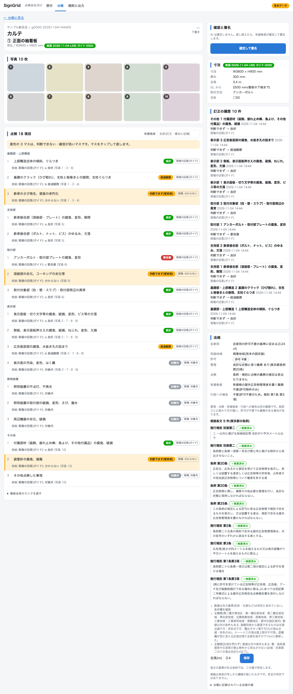
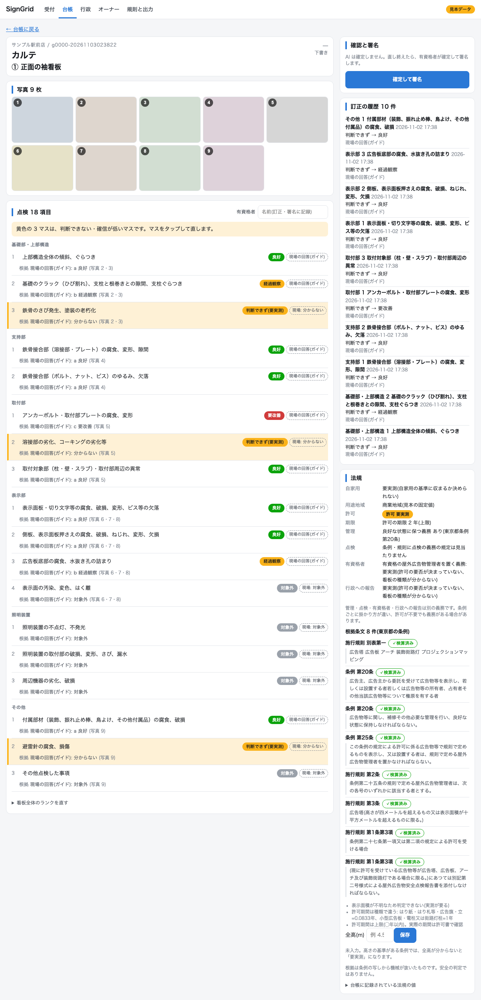

# 入口1: LINE

有資格者が現場で、看板の写真と記入済みの点検用紙の写真を LINE に送るだけ(行動は変えない)。
送られた物は看板管理台帳の下書きの元(束)になる。位置は写真の EXIF から読む。

## 何が起きるか

1. LINE が `POST /line/webhook` を呼ぶ。`X-Line-Signature` を `LINE_CHANNEL_SECRET` で検証し、合わなければ 401 で何もしない。
2. 画像は Messaging API の content エンドポイントから取得し、`data/private/line_inbox/<userId>/<日付>/<メッセージID>.jpg` に保存(未追跡)。
3. 同じ送信者から直前のメッセージの 10 分以内に届いた物は 1 件の「現場の束」にまとまる(最初から数えず、最後のメッセージからの 10 分)。
   台帳には次のように入る。
   - `bundles`: 1 束 1 行。`file` は `line://<userId>/<日付>/<最初のメッセージID>`(入口2の PDF と区別する印。台帳に kind 列は無い)。`status` は `pages_registered`。
   - `pages`: 届いた画像 1 枚が 1 ページ。種別は `不明`(写真か点検用紙かは後段の分類役が決める)。画像パスは絶対パス。
   - `sites`: 位置が取れた時だけ作る(id は `line-<束id>`、名前は `LINE受信 日付 時刻`)。位置は束で最初に取れた GPS(写真の EXIF、または LINE の位置情報メッセージ)。
   - テキストは `messages.jsonl` にメモとして残すだけで、現場名や台帳の項目にはしない。
4. 返事は 1 回の配信につき 1 通。例: `受け取りました。写真 6 枚。看板カルテの下書きを作っています`(枚数は束の累計)。挨拶・受付番号・待たせる文言は出さない。友だち追加のときだけ案内を 1 通。
5. LINE の再送(同じメッセージ ID)は数えず、返事もしない。画像を取得できなかった時は、その枚数だけ返事に添える。

## 現場の決め方(v2)

LINE の通常送信は写真の EXIF から GPS を落とすので、位置は次の順で決める。

1. 束に位置も現場も無い時、返信に「今日の現場はどれですか」と、案件(`data/sample/jobs.json`、予定日が今日±1日、最大4件。見本の案件は日付を `day_offset`(今日からの日数)で持ち、読み込む時に今日から決めるので、いつ開いても3件とも出る)+「その他(現在地を送る)」のクイックリプライを付ける。
   選ぶと(postback)`bundles.site_id` に案件の現場(`sites.id = job-<案件ID>`)を紐づけ、住所・自治体・座標(国土地理院の住所検索 API、`<inbox>/address_cache.json` にキャッシュ、1秒1回以下)を入れて「〇〇で受け付けました」と返す。
   「その他」は現在地を送るボタン(`https://line.me/R/nv/location`)を返す。案件の出どころは `serve --jobs` で差し替える(実運用は SignJOBZ の点検指示書、後日接続)。
2. 位置情報メッセージは、同じ送信者の直近 60 分以内で現場の無い最新の束に付ける(無ければ従来どおり)。写真の束ねは 10 分窓のまま。
3. リッチメニュー(2×2: 写真を送る / 現在地を送る / 今日の案件 / ガイド付き点検): `cli richmenu --dry-run` で JSON と画像(2500×1686、`data/private/richmenu.png`)を作り、`--apply` で LINE に作成・既定に設定。

返信の送信結果は logger `kanban_karte.line` に出る(成功 `reply ok 1通 bundle=#n`、失敗は HTTP ステータスと本文)。

## ガイド付き点検

「LINE のメッセージに誘導されたとおりに写真を撮り、a/b/c を押すだけで点検が完了する」入口。未経験でもすぐでき、項目のミス漏れを防ぐ。
有資格者の今の使い方(写真と用紙を送るだけ)は変わらず、これは**別の入口**。始めるのは、リッチメニューの「ガイド付き点検」(postback `act=guide&start=1`)か、テキスト「点検開始」。
**確定は従来どおり有資格者**(Web の確認画面)。ガイドの答えは下書きで、看板全体のランクは付けない。

### 流れ(intake/line/guide.py)

1. 現場: 直近 10 分の束に現場(位置か案件)があれば飛ばす。無ければ「今日の現場はどれですか」+案件のクイックリプライ(「その他(現在地を送る)」も使える)。
2. 看板の名前か番号(テキスト 1 通)。
3. 全景を 1 枚(必須)。
3a. 表示面を正面から(面が複数あれば各面、4 枚まで。東京都の報告書は全景と表示面(各面)の写真が必須)。撮れなければ「正面から撮れない」。
3b. 看板の種類 [ポール / 自立・野立て / 壁面 / 突出(袖)/ 屋上 / 置き看板 / その他]。台帳の `signs.type` に入れ(既にあれば上書きしない)、部位の問いに種類ごとの撮る場所を 1 行添える(`intake/line/shoot.py`)。
3'. 寸法の実測(台帳にその看板の寸法(幅×高さ)が無い時だけ。初回の点検。**最初の問いで「飛ばす」で通せる**)。[測る / 図面で送る / 飛ばす]。測る= 幅(mm)→ 高さ(mm)→ 厚み(任意)→ GL から看板の下端まで(mm)→ 取付方法 → 支柱。図面で送る= 図面の写真・画像 1〜3 枚(数字は聞かない)。詳しくは「寸法の実測」。
4. 部位ごと(`ledger/items.py` の 6 部位の順: 基礎部・上部構造 → 支持部 → 取付部 → 表示部 → 照明装置 → その他): 近くで 1〜3 枚 →(「次へ」。3 枚で自動的に次へ。その部位が無ければ「この部位は無い」= その部位の項目は全部「対象外」)→ その部位の項目を 1 項目ずつ。項目は点検様式の原文のまま。
   答えのボタンは `a 良好 / b 経過観察 / c 要改善 / AI 判定 / 対象外`(postback `act=guide&ans=a|b|c|unknown|na&item=<項目キー>`)。
5. 全部終わると「この看板は終わりです。次の看板を始めますか」[次の看板 / 終了]。

途中の自由な文は「戻る」「飛ばす」「やめる」だけ命令(飛ばす = その項目は「AI 判定」と同じ。正面と種類も飛ばせる。現場・看板名・全景は飛ばせない)。ほかの文はメモ(`messages.jsonl`)に残る。
進行は `<inbox>/<userId>/guide.json` に持ち、サーバを再起動しても続く。ガイドの写真も、10 分窓の束(従来と同じ)に入る。ボタンだけ押している間も束が切れないよう、ガイド中は押すたびに束の時刻を更新する。
古いボタン(今の問いと合わない・再送)は押しても進まず、今の問いを出し直す。

### 会話の例(`simulate --guide data/sample/guide_plan.json` の出力そのまま。[ ] は返事に付くボタン、→ は人の操作)

```
→ メニュー「ガイド付き点検」を押す
今日の現場はどれですか
  [サンプル北口店 / サンプル駅前店 / サンプル国道店 / その他(現在地を送る)]
→ サンプル駅前店
サンプル駅前店で受け付けました
看板の名前か番号を送ってください(例: ① 正面の袖看板)
→ 「① 正面の袖看板」を送る
全景を1枚撮ってください
→ 写真 1 枚(全景)
全景を受け取りました
表示面を正面から撮ってください(文字や絵が読めるように。面が複数あれば各面)
  [正面から撮れない]
→ 写真 1 枚(正面)
正面 1枚
別の面があれば続けて撮るか、「次へ」を押してください
  [次へ]
→ 次へ
看板の種類を選んでください
  [ポール / 自立・野立て / 壁面 / 突出(袖) / 屋上 / 置き看板 / その他]
→ 突出(袖)
この看板の寸法を測りますか(初回の点検では、測って台帳に残します。図面があれば図面で送れます)
  [測る / 図面で送る / 飛ばす]
(寸法の実測は下の「寸法の実測」。測り終えると部位へ)
基礎部・上部構造を撮ってください(近くで1〜3枚)
突出の看板には基礎が無いことが多いです。無ければ「この部位は無い」
  [この部位は無い]
→ この部位は無い(基礎部・上部構造の 3 項目は「対象外」)
支持部を撮ってください(近くで1〜3枚)
ブラケット(壁から出ている金物)とカバー、振れ止め棒を、下から見上げて
  [この部位は無い]
→ 写真 1 枚
支持部 1枚
続けて撮るか、「次へ」を押してください
  [次へ]
→ 次へ
支持部 1/2
鉄骨接合部（溶接部・プレート）の腐食、変形、隙間
  [a 良好 / b 経過観察 / c 要改善 / AI 判定 / 対象外]
→ a 良好
支持部 2/2
鉄骨接合部（ボルト、ナット、ビス）のゆるみ、欠落
  [a 良好 / b 経過観察 / c 要改善 / AI 判定 / 対象外]
→ a 良好
取付部を撮ってください(近くで1〜3枚)
壁に留めている所と、その周りの壁(さびの垂れ跡・隙間・ひび)を
  [この部位は無い]
→ 写真 1 枚 → 次へ
取付部 1/3
アンカーボルト・取付部プレートの腐食、変形
  [a 良好 / b 経過観察 / c 要改善 / AI 判定 / 対象外]
→ c 要改善
取付部 2/3
溶接部の劣化、コーキングの劣化等
  [a 良好 / b 経過観察 / c 要改善 / AI 判定 / 対象外]
→ AI 判定
(…取付部 3/3、表示部も同じ形。撮る場所の一行は看板の種類で変わる。表示部は 3 枚撮ると「次へ」を待たず項目に進む)
(…照明装置が無ければ「この部位は無い」。その他 3/3 まで答える)
この看板は終わりです。次の看板を始めますか
  [次の看板 / 終了]
→ 終了
点検のまとめ(…)   ← 看板ごとの内訳と現場の合計。全文は「v4: 戻る・まとめ・照明・自動下書き」
```

メモを送った時は「メモを受け取りました」を頭に付けて今の問いを出し直す(ボタンを残すため)。やめる: 「ガイドをやめました。ここまでの分は台帳に残っています」。
返事は 3 行まで(撮る場所の一言は部位の問いの 2 行目、どの写真で見るかの一言は項目の行の末尾に付ける)。

### 看板の種類と撮る場所(intake/line/shoot.py)

部位(点検箇所)と項目は東京都 第2号様式のまま。種類で部位を省かない(無い部位は「この部位は無い」)。高所に登らせない: 「上部構造全体の傾斜、ぐらつき」は、傾きを全景で、ぐらつきを手の届く所で確かめる(国交省の指針(案)は点検を原則「目視、打診等」とし、自治体のパトロールは路上からの目視が基本。東京都は具体的な方法を定めず、設置状況によっては高所作業車)。
全景は基礎部・上部構造の項目の根拠の写真に、正面は表示部の項目の根拠の写真に数える。
文言は 2026-11-04 の案で、有資格者の確認待ち。出典: 東京都「屋外広告物安全点検報告書の様式改正」と説明会の質疑応答・スライド(2025-07-01)、国土交通省「屋外広告物の安全点検に関する指針(案)」(2017)、日広連ほか「屋外広告物点検基準(案)」(2016)、「オーナーさんのための看板の安全管理ガイドブック」(2024)。

| 部位 | ポール | 自立・野立て | 壁面 | 突出(袖) | 屋上 | 置き看板・その他 |
|---|---|---|---|---|---|---|
| 基礎部・上部構造 | 支柱の根元(基礎・根巻きとの隙間・ひび)を近くで。傾きは全景で見ます(登らなくてよい) | 脚の根元(基礎・根巻きとの隙間・ひび)を近くで。傾きは全景で見ます(登らなくてよい) | 壁面の看板には基礎が無いことが多いです。無ければ「この部位は無い」 | 突出の看板には基礎が無いことが多いです。無ければ「この部位は無い」 | 架台の脚元(基礎・アンカー)を近くで | 置いてある場所(傾き・キャスター)を(置き看板)/ 地面との境目(基礎)を近くで。傾きは全景で見ます(その他) |
| 支持部 | 支柱と看板の接合部(串刺しは首回り、盤上は接合のボルト)を、地上から見える範囲で | 脚と看板をつなぐ鉄骨・接合部(ボルト・溶接)を | 側板・押さえ枠と、表示面板の継ぎ目を | ブラケット(壁から出ている金物)とカバー、振れ止め棒を、下から見上げて | 架台の鉄骨と接合のボルトを | 看板を支えている鉄骨と接合部を |
| 取付部 | 看板を支柱に留めている所(プレート・ボルト)を | 看板を脚に留めている所を | 壁との隙間・コーキング・さびの垂れ跡(汚ダレ)を。取付金物は外から見えないことが多いです | 壁に留めている所と、その周りの壁(さびの垂れ跡・隙間・ひび)を | 架台を建物に留めている所(アンカー)を | 看板を建物や支柱に留めている所を |
| 表示部 | 表示面の傷み・側板・底と水抜き穴を近くで | 表示面の傷み・側板・底と水抜き穴を近くで | 表示面の傷み・側板・底と水抜き穴を近くで | 表示面の傷み・側板・底と水抜き穴を近くで | 表示面の傷み・側板・底と水抜き穴を近くで | 表示面の傷み・側板・底と水抜き穴を近くで |
| 照明装置 | 照明器具と配線(あれば)。器具の傾き・外れも | 照明器具と配線(あれば)。器具の傾き・外れも | 照明器具と配線(あれば)。器具の傾き・外れも | 照明器具と配線(あれば)。器具の傾き・外れも | 照明器具と配線(あれば)。器具の傾き・外れも | 照明器具と配線(あれば)。器具の傾き・外れも |
| その他 | 付属物(振れ止め・鳥よけ・避雷針など)を | 付属物(振れ止め・鳥よけ・避雷針など)を | 付属物(振れ止め・鳥よけ・避雷針など)を | 付属物(振れ止め・鳥よけ・避雷針など)を | 付属物(振れ止め・鳥よけ・避雷針など)を | 付属物(振れ止め・鳥よけ・避雷針など)を |

### 寸法の実測(intake/line/measure.py、guide.py)

点検には看板のサイズを実測する工程が入ることがある(特に初回)。法規の「要実測」は、初回に測って台帳に入れ、次回から引き継ぐ。写真からの寸法推定(`dim/`)は、実測が無い時の下書き。
種類の後、部位の前に出る。**台帳に同じ現場・同じ名前の看板で幅×高さが入っていれば出さず**(引き継ぎ)、最後に 1 行知らせる。

数字はテキスト 1 通。全角(`３，６００`)・単位付き(`3600mm` / `3.6m` / `360cm`)も受ける。単位が無い数字は取り違えを避けるため次のとおり:

| 送った数字 | 扱い |
| --- | --- |
| 1000 以上(`3600`) | mm としてそのまま受ける |
| 0.1〜50(`3.6` / `3` / `30`) | m とみなし「X m(Y mm)として受け取ります。合っていますか」[はい / 入れ直す] |
| 100〜999 の整数(`900`) | m だと 50 m を超えるので mm とみなし、同じく確認を返す |
| 範囲外(幅・高さは 100〜50000 mm、厚みは 10〜5000 mm) | 範囲を伝えて聞き直す |

会話の例 — 測る(`simulate --guide` の ① の出力そのまま):

```
この看板の寸法を測りますか(初回の点検では、測って台帳に残します。図面があれば図面で送れます)
  [測る / 図面で送る / 飛ばす]
→ 測る
幅(mm)を送ってください(例: 3600。3.6m のように単位を付けても受けます)
→ 「3.6m」を送る
高さ(mm)を送ってください(例: 900)
→ 「900」を送る
「900」を 900 mm(0.9 m)として受け取ります。合っていますか
  [はい / 入れ直す]
→ はい
厚み(奥行き、mm)を送ってください(例: 300)。分からなければ「分からない」
  [分からない]
→ 「300」を送る
「300」を 300 mm(0.3 m)として受け取ります。合っていますか
  [はい / 入れ直す]
→ はい
GL(地面)から看板の下端までの高さ(mm)を送ってください(例: 2500)。分からなければ「分からない」
  [分からない]
→ 「2500mm」を送る
取付方法を選んでください
  [アンカーボルト / 溶接・プレート / ボルト・ナット・ビス / ブラケット / ポール 串刺し式 / ポール 盤上式 / 二柱式 / 基礎・根巻き / 置くだけ / バンセン / 吊り / その他(文字で入力) / 分からない]
→ アンカーボルト
支柱があれば送ってください(例: □50)。無ければ「無し」
  [無し]
→ 「□50」を送る
基礎部・上部構造を撮ってください(近くで1〜3枚)
突出の看板には基礎が無いことが多いです。無ければ「この部位は無い」
  [この部位は無い]
```

会話の例 — 図面で送る(② の出力そのまま。数字の問いは出さない。寸法は事務所で図面から入れる):

```
この看板の寸法を測りますか(初回の点検では、測って台帳に残します。図面があれば図面で送れます)
  [測る / 図面で送る / 飛ばす]
→ 図面で送る
図面の写真か画像を送ってください(1〜3枚)
  [数字で入れる]
→ 図面の写真 1 枚
図面 1枚
続けて送るか、「次へ」を押してください
  [次へ]
→ 次へ
図面 1枚を受け取りました。寸法は図面から事務所で入れます
基礎部・上部構造を撮ってください(近くで1〜3枚)
壁面の看板には基礎が無いことが多いです。無ければ「この部位は無い」
  [この部位は無い]
```

「飛ばす」を押すと「寸法の実測は飛ばしました」に続けて部位の問いが出る(台帳の寸法は空のまま)。

2 回目以降(③ は ① と同じ名前): 種類の次はすぐ部位の写真で、実測の問いは出ない。最後に 1 行付く。

```
寸法は前回(2026-11-04)の実測を引き継ぎました
この看板は終わりです。次の看板を始めますか
  [次の看板 / 終了]
```

途中の「戻る」は 1 つ前の問い、「飛ばす」は最初の問いと(幅・高さがまだ揃っていない時の)幅・高さでは実測そのもの、厚み・GL・取付方法・支柱ではその 1 問だけを飛ばす。図面の待ちで「飛ばす」「次へ」を押すと、送った分を受け取って部位へ進む。「やめる」はここまでの分を台帳に残して終える。
幅・高さが揃った時点で台帳に書くので、途中でやめても入力済みの分は残る。

取付方法のボタン(13 個+「戻る」は上限を超えるので 2 ページ。1 ページ目は先頭 11 個+「次のページ(その他・分からない)」+「戻る」、2 ページ目は残り 2 個+「前のページ」+「戻る」): アンカーボルト / 溶接・プレート / ボルト・ナット・ビス / ブラケット / ポール 串刺し式 / ポール 盤上式 / 二柱式 / 基礎・根巻き / 置くだけ / バンセン / 吊り / その他(文字で入力) / 分からない。「その他(文字で入力)」を押すと文字で受ける(30 字まで)。
一覧は東京都 第2号様式と国交省の指針(案)の項目名(アンカーボルト・溶接・プレート・ボルト・ナット・ビス)、ガイドブックと点検基準(案)のポールの形式(串刺し式・盤上式・二柱式)・置看板から組み、バンセン・吊りは客先の手描きスケッチ(1 店舗)に実際にあった物を残した。取付方法をはっきり分類した一次資料は見つかっていない(2026-11-04 案、有資格者の確認待ち)。
スケール(巻尺)を当てた写真は撮らない(2026-11-04 まで撮っていたが、数字を文字で入れるので判定にも様式にも使っていなかった。古い台帳の写真はタグ「実測」のままカルテに出る)。

台帳(`signs`): `size_w` / `size_h` / `size_d`(厚み、mm)、`size_source='measured'`、`size_by`(`line_guide:<userId 末尾4桁>`)、`size_at`(日付)、`gl_mm` と `gl_edge='bottom'`(看板の下端まで)、`mount`、`post`、`type`(種類)。全高 `height_m` = GL + 高さ(GL が分からなければ入れない)。
図面は `pages.tag='図面'`。看板の写真の末尾に置き、下書きの入力・点検様式の写真には入れない(判定役には渡さない)。
法規は、カルテを開くたびに面積(幅×高さ)と全高で再判定されるので、実測が入ると高さ・面積の基準がある条例の「要実測」が減る。
カルテの寸法欄には出どころのバッジが付く: 実測(日付・by)/ 推定(AI)/ 図面(スケッチ)/ 登録値(出どころ未記録)/ 未入力。




### v4: 戻る・まとめ・照明・AI 判定の自動下書き(2026-11-05)

- **戻る**: 現場の選択を除くすべての問い(写真・選択・数字)のクイックリプライの最後に「戻る」が付く(ボタンは今の問いの位置を持ち、古いボタンは余計に戻らず今の問いを出し直す)。写真の工程で戻ると、直前の写真の `pages.tag` を外す(ファイルと `signs.photos` は残す。部位の写真・正面・全景・図面)。「やめる」は従来どおり。
- **まとめ**(終了で 1 通。URL は入れない): 看板ごとに 名前・種類・寸法(W×H×D、GL)・写真枚数・要改善/経過観察/良好/AI 判定 の数 → AI 判定の項目があれば、自動下書きが ON で鍵がある時「AI 判定 n 項目は写真から下書き中(数分)。結果は PC の台帳で」、OFF か鍵が無い時「AI 判定の項目は PC で下書きします」(0 項目なら何も書かない) →「下書きとして台帳に保存しました。確認と確定は PC の台帳で行います」→「カルテと様式は PC の台帳で確認・訂正できます」→「次の看板はメニューの「ガイド付き点検」から」→ その現場の今日の看板すべての合計 1 行 →「お疲れさまでした」。5000 字を超える時は行の区切りで切り、1 回の返信に最大 5 通で続ける。
- **照明**: 実測の工程では取付方法の次に 1 問(内照式 / 外照式 / 無し / 分からない)。実測を飛ばす・引き継ぐ・図面で送る看板は、この 1 問だけ聞く。`signs.lighting` に 内照式 / 外照式 / 無し(分からないは NULL。古い台帳には起動時に列を足す)。内照式は照明装置の撮る場所が「点灯した状態の表示面(できれば)、面板の裏側や電源部が見える所、配線の引き込み」になる。外照式・分からない(照明の種類)は従来のまま。無しは照明装置の 3 項目を対象外(`guide=na`)にして問わない。点検項目の 18 は変えない。
- **AI 判定の自動下書き**: 終了時に AI 判定の項目がある看板の束を、環境変数 `LINE_GUIDE_AUTO_DRAFT=1`(既定は OFF)かつ下書きの鍵(`ANTHROPIC_API_KEY` か `.env`)がある時だけ、webhook の応答のあとに別スレッドで `web.api.draft_bundle`(Web の「下書きを作る」と同じ関数。ガイドの看板なので `only_missing`)で下書きする。結果の通知(push)は無い。現場の作業はすべて下書き(`status=draft`)のまま。確認と確定は PC の台帳(有資格者)で行う。

### 台帳に残る物(intake/line/guide_ledger.py)

| 場所 | 中身 |
| --- | --- |
| `signs` | 看板を下書き(`status=draft`)で作る。`name`=送られた名前、`draft_by`=`line_guide:<userId 末尾4桁>`、`rank` は空(有資格者が PC の台帳で確定) |
| `pages` | 写真は束のページ(種別「写真」)。`tag` 列に `overview`(全景)か部位名 |
| `signs.items` | a→良好 / b→経過観察 / c→要改善。「AI 判定」「対象外」は入れない |
| `signs.lighting` | 内照式 / 外照式 / 無し。分からないは NULL |
| `signs.evidence` | 項目ごとに `guide`(a/b/c/unknown/na)と、その部位の写真番号 |
| `corrections` | a/b/c の答えを `by=line_guide` で 1 行(有資格者の訂正と区別できる) |

カルテ(Web)では、現場の答えの項目に「現場の回答(ガイド)」のバッジが付く(有資格者が直した項目、AI が下書きし直した項目では出ない)。「AI 判定」は黄色のまま、「対象外」は黄色にしない。




### 「AI 判定」だけ AI が下書きする

`pipeline.draft.draft_bundle(..., only_missing=True)` は、答えのある項目を上書きせず、「AI 判定」(内部の値 `unknown`)と未回答の項目だけを写真から下書きする(判定役にもその項目だけを尋ねる。「対象外」は触らない)。既定(`only_missing=False`)は従来どおり全項目。Web の「下書きを作る」は既定のまま。

### 模擬で一周する

```
python3 -m kanban_karte.intake.line.cli simulate --guide data/sample/guide_plan.json
python3 tools/web_screenshots.py --only guide      # docs/img/guide-karte-{pc,sp}.png と guide-measure-{pc,sp}.png
```

## チャネル作成後に設定するもの

環境変数(コミットしない。`.env` か実行環境のシークレットに置く):

| 名前 | 中身 | 取得場所 |
| --- | --- | --- |
| `LINE_CHANNEL_SECRET` | チャネルシークレット | LINE Developers コンソール > チャネル基本設定 |
| `LINE_CHANNEL_ACCESS_TOKEN` | チャネルアクセストークン(長期) | Messaging API 設定 |

LINE Developers コンソールの Messaging API 設定で:

- Webhook URL: `https://<後で入れる>/line/webhook`(公開 URL は Cloudflare Tunnel か Vercel かを本線が決める。決まったらここに書く)
- Webhook の利用: オン
- 応答メッセージ(自動応答)・あいさつメッセージ: オフ(返事はこのサーバが出す)

## ローカルでの起動と検証

LINE も鍵も無しで、署名つきの模擬 webhook を流して一通り確かめられる。

```
# 模擬: 画像フォルダを同じプロセスに立てた仮サーバへ送る(台帳・受信箱は data/private/line_sim/ に作る)
python3 -m kanban_karte.intake.line.cli simulate --images 画像フォルダ/
python3 -m kanban_karte.intake.line.cli simulate --images 画像フォルダ/ --location 35.68,139.69 --text 裏口

# 本番の形で起動(LINE に繋ぐ。上の 2 つの環境変数が要る)
LINE_CHANNEL_SECRET=... LINE_CHANNEL_ACCESS_TOKEN=... python3 -m kanban_karte.intake.line.cli serve --port 8787

# 別プロセスの serve へ模擬を送る(LINE に繋がない模擬サーバ。画像は --sim-content-dir から読み、返事は画面に出すだけ)
LINE_CHANNEL_SECRET=x python3 -m kanban_karte.intake.line.cli serve --sim-content-dir data/private/line_sim_content
LINE_CHANNEL_SECRET=x python3 -m kanban_karte.intake.line.cli simulate --images 画像フォルダ/ --url http://127.0.0.1:8787
```

`serve` の台帳は既定で `data/private/ledger.sqlite`(`--db` / `KANBAN_KARTE_DB`)、受信箱は `data/private/line_inbox`(`--inbox` / `KANBAN_KARTE_LINE_INBOX`)。
ヘルスチェックは `GET /healthz`。

## 未確認・注意

- LINE は、通常の写真送信で EXIF(位置)を落とす可能性がある。未検証。実機で「写真」として送った画像に GPS が残るか、`messages.jsonl` の `gps` で確認すること。残らない場合は、LINE の位置情報メッセージ(対応済み)か、ファイルとして送る運用が要る。
- 返事は reply token を使う。token は短時間で失効するので、画像の取得が長引くと返事に失敗することがある(保存は済む。失敗は `Delivery.errors` とログに出る)。
- 1 配信の処理は同期。画像が多い配信は LINE のタイムアウトに近づく可能性がある。必要になったらキューに分ける。
