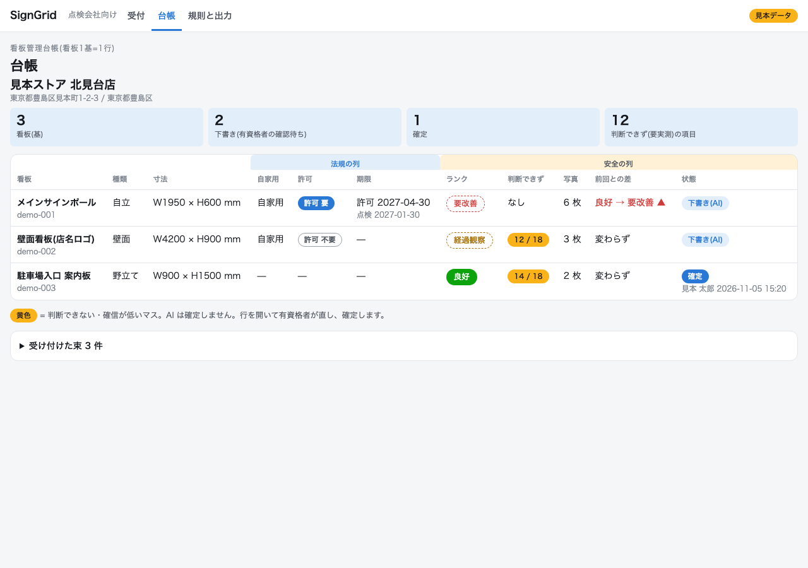
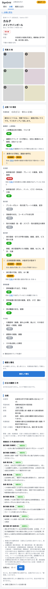
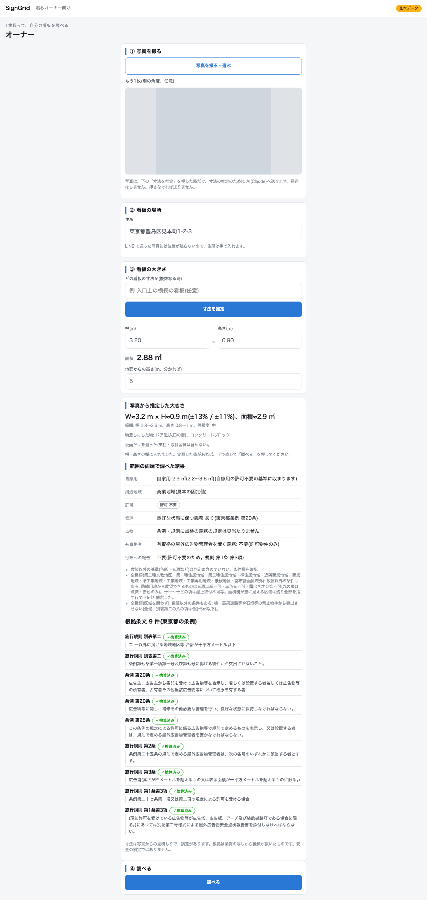
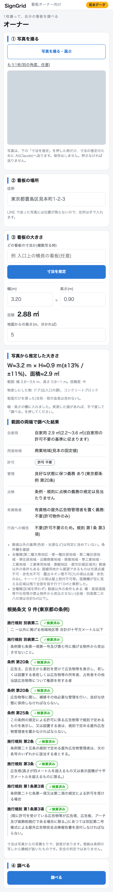

# 画面(kanban_karte/web/)

看板管理台帳(看板1基=1行)を、有資格者が PC とスマホで見て直して確定する画面。標準ライブラリの `http.server` と素の HTML/CSS/JS だけ(フレームワーク・ビルド・CDN なし)。画面の中身はすべて見本データ(架空の店名、無地の代用写真に番号)。

## 起動

```
python3 -m kanban_karte.web                                   # 見本データ(data/sample/)で起動。台帳は一時、再起動で消える
python3 -m kanban_karte.web --db <sqlite> --data-dir <dir>    # 自分の台帳(--port 既定 8790、127.0.0.1 だけ)
python3 -m kanban_karte.web --db <新しいsqlite> --sample      # 見本データを入れた台帳を作って起動
```

`--db` を省くと環境変数 `KANBAN_KARTE_DB`、無ければ `data/private/ledger.sqlite`、それも無ければ見本データ。画像は `--data-dir`(環境変数 `KANBAN_KARTE_DATA`)の下の相対パスを `/media/<相対パス>` で配る(下に収まらない・画像でないものは 404)。

## 画面

使う人ごとに入口を分ける(`<body data-entry>` で区別し、共有の `app.css`・`app.js` が入口ごとに許可されたルートだけ描く)。許可外のハッシュは入口の画面に戻す。社内入口で `#/gov` `#/owner` を開くと各入口へ転送する。`/gov` `/owner`(末尾スラッシュ無し)は `/gov/` `/owner/` へ転送(308)。見本データの帯は3入口とも出る。

| 入口 | 画面 | 内容 |
|---|---|---|
| `/`(社内。タブ= 受付 / 台帳 / 規則と出力。ブランド「SignGrid」)  受付(`#/intake`) | 受け付けた束の一覧。種別(`line://` の束は LINE、他は PC)・ファイル名・状態・看板数/下書き数・エラー、台帳(現場)へのリンク。下書き前の束には「下書きを作る」(鍵が無ければ無効で理由を表示) |
| `/`  台帳(`#/`) | 現場を選ぶ → 看板1基=1行。法規の列(自家用・許可・期限)と安全の列(ランク・判断できず N/18・写真枚数・前回との差・状態)。ランクは下書きが破線の薄い札、確定が塗りの濃い札。行で開く。スマホ幅では1基=1枚のカード。受け付けた束があれば「下書きを作る」(鍵が無ければ無効) |
| `/`  カルテ(`#/sign/<id>`) | 写真(タップで拡大・前後送り)、18項目の区分、各項目の根拠(evidence の文と写真番号、「写真3」は押せる)、所見、法規。黄色=判断できず/下書きが要実測としたマス。マスをタップ→区分を選ぶと即 POST、右側(スマホでは下)に訂正の履歴。「確定して署名」→ 名前つきで確認 → 確定。確定後は編集不可 |
| `/gov/`(ブランド「SignGrid 行政」・副題「巡回・窓口」、タブなし)  行政(`#/gov`) | 職員が撮った写真の一括登録(`kanban_karte.gov`)。赤/橙/緑/灰の件数、地図(`gov.map` の HTML を iframe で埋める。地理院タイル・出典表示つき)、候補の一覧(位置・束ねた写真数・近い台帳の看板・状態・許可の期限)。gov の表が無い台帳では「一括登録はまだありません」。`#/gov?today=YYYY-MM-DD` で基準日を指定 |
| `/owner/`(ブランド「SignGrid」・副題「看板オーナー向け」、タブなし)  オーナー(`#/owner`) | スマホ幅が基本。写真(1〜2枚。「寸法を推定」を押した時だけ縮小版を AI へ送る。保存しない)→住所(手入力)→幅×高さ(m、面積は自動。推定すると値が入り、手で直せる)→「調べる」。自家用の許可の要否と、点検まわりの4行(管理 / 点検 / 有資格者 / 行政への報告)と根拠条文。4行は法規役の `duties` の文言のまま条文つきで出す(例「点検: 3年ごとに点検 義務あり(埼玉県条例 第14条の2 第1項、規則 第10条の4 第1項)」)。『誰も点検していない可能性があります』の文は削除した(埼玉県では許可不要でも点検の義務がある)。鍵が無い時は「寸法を推定」が無効。安全の判定(ランク・18項目)は出さない。「看板屋に点検を頼む」は宛先が空の `mailto:` |
| `/`  規則と出力(`#/rules`) | 訂正から育った規則(同じ項目・同じ所見で区分が違う規則に「矛盾の可能性」の印)、現場ごとの「東京都 第2号様式を出力」「客先A型を出力」(xlsx ダウンロード。出力は常に下書き) |

## API(JSON)

画面は台帳(`ledger/`)と本線(`pipeline/`・`output/`)の関数を呼ぶだけで、規則の作り方・ランクの再計算・様式はそちらが持つ(`web/api.py`)。

| | |
|---|---|
| `GET /api/meta` | 見本データか、下書きを作れるか(鍵の有無)、18項目の定義 |
| `GET /api/sites`、`GET /api/signs?site=` | 現場(看板数・下書き数・確定数)、看板の一覧(1行分) |
| `GET /api/signs/<id>` | 看板の全部(項目・根拠・黄色・写真の URL・訂正の履歴) |
| `POST /api/signs/<id>/items` | `{item, value, by, note?}` 訂正。`item` は項目キーか `rank`(1〜4)。`pipeline.review.apply_correction` |
| `POST /api/signs/<id>/finalize` | `{by}` 確定。`pipeline.review.finalize`。確定済みへの訂正・確定は 409 |
| `GET /api/bundles`、`POST /api/bundles/<id>/draft` | 束の一覧、下書き(`pipeline.draft.draft_bundle`。鍵が無ければ 503) |
| `GET /api/gov/batches?today=` | 一括登録の一覧(写真数・候補数・色別件数)。gov の表が無ければ `available:false` |
| `GET /api/gov/candidates?batch=` | 候補(位置の有無・束ねた写真数・近い台帳の看板・状態/色・期限)。赤→橙→緑→灰の順 |
| `GET /api/gov/map.html?batch=` | `gov.map.write_map` の HTML(iframe 用) |
| `POST /api/gov/upload` | `{photos:[{data(base64), lat?, lng?, taken_at?, position_source?}], batch_name?}`(1〜30枚・1枚12MB)→ `{batch_id, candidates, no_position, photos, skipped, position_sources, geocode_pending}`。位置で束ねて新しい束にし、写真は `gov_uploads/<束id>/` に保存。詳しくは GOV.md |
| `POST /api/owner/estimate` | `{photos:[base64 JPEG 1〜2枚], address, target_name?, height_m?}` → `{estimate(W/H・範囲・参照物・信頼度), judgement(範囲の両端の法規の判定。height_m= 全高があれば両端に渡す)}`。鍵が無ければ 503。台帳に書かない・写真を保存しない |
| `POST /api/owner/judge` | `{address, area_m2, height_m?}` → 法規役 `judge(use="self")` の結果。台帳には書かない |
| `GET /api/signs/<id>` の `legal` | 看板の住所(無ければ現場)・自家用か・寸法(size の mm から面積)で `judge()`。面積が取れなければ「要実測」。全高は台帳に無いので渡さない |
| `GET /api/rules` | 規則(`conflicts_with`・両方向の `conflicts`・`status`・`structured` つき) |
| `POST /api/rules/<id>/approve` `/reject` | 規則の承認・却下(`by` 必須)。承認済みと矛盾する規則の承認は 409 |
| `POST /api/rules/resolve` | 矛盾の組を解く `{keep, drop, by, reason}`(残す側 approved・他方 rejected) |
| `POST /api/rules/<id>/answer` | 聞き返しの答え `{question, answer, by}` → 候補の規則を構造化(docs/PIPELINE.md §2) |
| `GET /api/sites/<id>/output/tokyo.xlsx` / `client-a.xlsx` | 様式の出力 |
| `GET /media/<相対パス>` | 写真 |

POST は `Content-Type: application/json` だけ受ける(他サイトのフォームからの送信を避ける)。

## スクリーンショット

`python3 tools/web_screenshots.py`(Playwright / Chromium。見本データの一時台帳で PC 1280 とスマホ 390 を撮り `docs/img/` に書く)。

| | PC 1280 | スマホ 390 |
|---|---|---|
| 台帳 |  |  |
| `/`  カルテ(黄色のマス) |  |  |
| 黄色のマスを直した後(履歴に出る) |  |  |
| 確定して署名した後 |  |  |
| `/`  台帳(確定後) |  |  |
| `/`  規則と出力(矛盾の印) |  |  |

360 / 390 / 1280 幅で横スクロールが出ないことを確認済み。

## モックとの違い

- モックは6画面。この画面は有資格者の側(受付の下書き・台帳・カルテ・確認と署名・出力)だけ。LINE の受付(別の入口)、オーナー、行政の地図(`gov/` の `map.html`)はここに入れていない。
- モックの「要確認」は「判断できず(要実測)」と書く(台帳・pipeline の用語。区分に「要確認」は無い)。項目名は様式の原文(モックの略記ではなく)。
- 確認は、モックの「1/3 の次へ」ではなくカルテの18項目の一覧上でマスをタップして直す(スマホでもそのまま押せる)。
- 見本の写真は無地の画像に番号を重ねたもの。

推定後のオーナー画面:  (推定役は固定の見本値で、実際の推定結果ではない)
